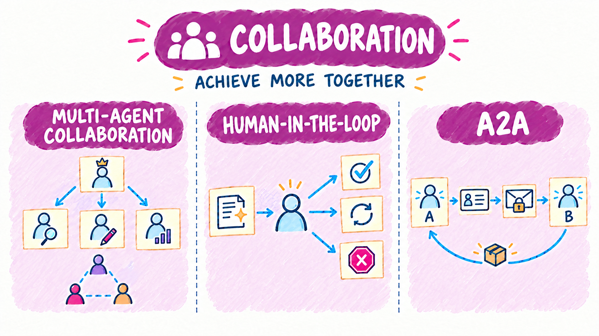
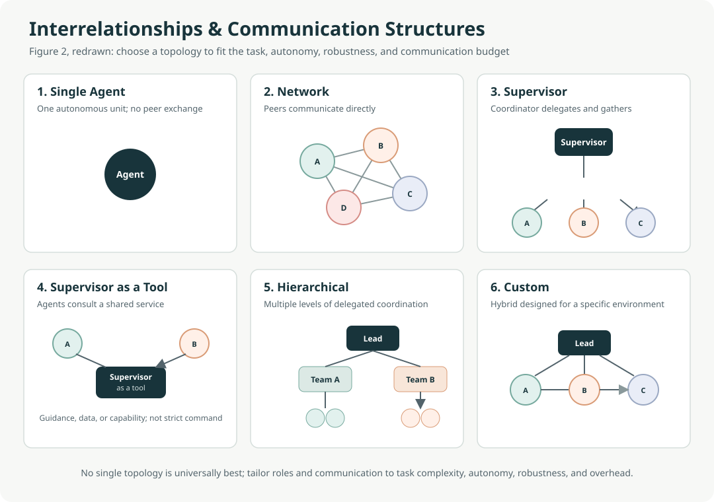
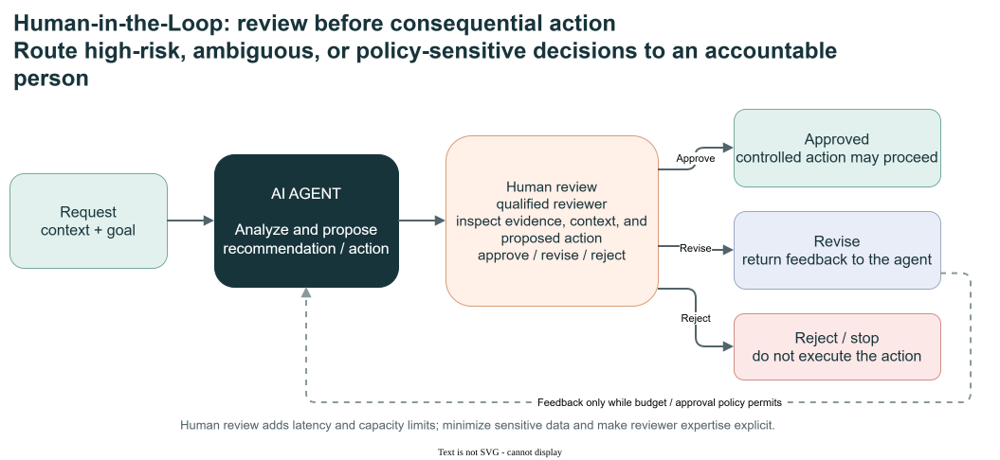
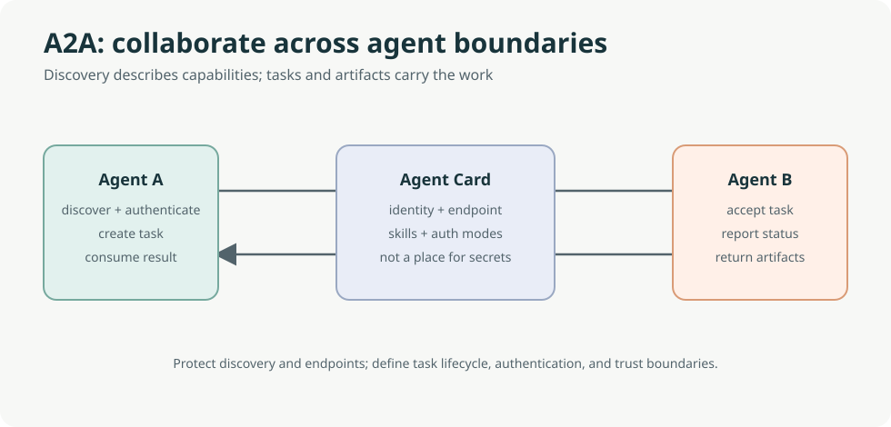

# Collaboration

[Overview](design-patterns.md) | [Flow](flow.md) | [Reason & Improve](reason-and-improve.md) | [Knowledge & Action](knowledge-and-action.md) | **Collaboration** | [Trust & Operations](trust-and-operations.md)

Collaboration patterns distribute work across **multiple actors**. These can be specialised agents, remote agents reached over a protocol, or people who approve and correct.

- **Use when** the problem decomposes into roles with different instructions, tools, or models, or when a decision needs human accountability.
- **Watch for** coordination overhead, lost context between agents, and approval fatigue.

The opening illustration is a conceptual overview, not an exact execution trace or a promise of particular retry counts, capabilities or acceptance. The pattern diagrams and **Demo contract** notes below distinguish the concepts from runnable behavior.

In the A2A panel, the card represents discovery metadata. The caller sends a separate request to the remote endpoint; the card itself neither sends requests nor grants authorization.

## Patterns in this family

| Pattern | C# / MAF demo |
|---|---|
| [Multi-Agent Collaboration (Chapter 7)](#multi-agent-collaboration-chapter-7) | [MultiAgent](../dotnet/src/MultiAgent/README.md) |
| [Human-in-the-Loop (HITL, Chapter 13)](#human-in-the-loop-hitl-chapter-13) | [HumanInTheLoop](../dotnet/src/HumanInTheLoop/README.md) |
| [Inter-Agent Communication (A2A, Chapter 15)](#inter-agent-communication-a2a-chapter-15) | [A2A](../dotnet/src/A2A/README.md) |

Read in order using **Previous / Next** below, or jump directly to a pattern. Book chapter numbers are provenance; Decision Models and Agent Harness are repository additions.

## Multi-Agent Collaboration (Chapter 7)

**C# demo:** [MultiAgent](../dotnet/src/MultiAgent/README.md) | [Family contents](#patterns-in-this-family)

Agents with distinct roles, tools, or knowledge can collaborate through sequential handoffs, parallel sub-tasks, debate, hierarchical delegation, expert teams, or critic-reviewer cycles. Common structures include peer networks, a central supervisor, a supervisor consulted as a tool, and multi-level hierarchies. These structures can be combined; they are options rather than a fixed taxonomy.

Use collaboration when a task decomposes into parts that benefit from specialization or parallel work. Choose a structure based on task complexity, team size, desired autonomy, and robustness needs. Account for coordination overhead, context loss, bottlenecks, and clear responsibility for the final result.

Editable diagram: [multi-agent-structures.drawio](images/multi-agent-structures.drawio).

Original book illustration: [Figure 113.1](../book/Agentic_Design_Patterns_Complete.pdf).

**Demo contract:** In-process role/orchestration examples. **Boundary:** Distributed Responses workers are not A2A.

**Previous:** [Knowledge Retrieval (RAG, Chapter 14)](knowledge-and-action.md#knowledge-retrieval-rag-chapter-14) | [Family contents](#patterns-in-this-family) | **Next:** [Human-in-the-Loop (HITL, Chapter 13)](#human-in-the-loop-hitl-chapter-13)

## Human-in-the-Loop (HITL, Chapter 13)

**C# demo:** [HumanInTheLoop](../dotnet/src/HumanInTheLoop/README.md) | [Family contents](#patterns-in-this-family)

People can supply missing context, correct errors, review outputs, or approve, reject, and redirect consequential actions. Human review is particularly important for high-risk, ambiguous, or policy-sensitive decisions; use a qualified reviewer when the decision requires specialist judgment.

Define who reviews, what information they need, what approval or rejection does to the workflow, and when the system must stop or escalate. Balance safety and accountability against review latency and throughput, and minimize or anonymize sensitive information shown to reviewers.

Editable diagram: [human-in-the-loop-visual-summary.drawio](images/human-in-the-loop-visual-summary.drawio).

Original book illustration: [Figure 209.1](../book/Agentic_Design_Patterns_Complete.pdf).

**Demo contract:** No action before explicit approval. **Boundary:** Hosted persistence/ownership is a separate protocol contract.

**Previous:** [Multi-Agent Collaboration (Chapter 7)](#multi-agent-collaboration-chapter-7) | [Family contents](#patterns-in-this-family) | **Next:** [Inter-Agent Communication (A2A, Chapter 15)](#inter-agent-communication-a2a-chapter-15)

## Inter-Agent Communication (A2A, Chapter 15)

**C# demo:** [A2A](../dotnet/src/A2A/README.md) | [Family contents](#patterns-in-this-family)

A2A is a protocol for communication and collaboration between agents built with different frameworks; it complements MCP, which standardizes agent-to-tool and context access. An Agent Card describes an agent's identity, endpoint, skills, capabilities, input/output modes, and authentication requirements. Tasks track units of work and their lifecycle; messages and parts carry content, while artifacts represent deliverables. Interaction can include request/response, polling, streaming, or push notifications where supported.

Use A2A when independently built or deployed agents must collaborate across process or framework boundaries. For components within one application, a local workflow or framework-native handoff is often simpler. Protect discovery and endpoints, declare authentication requirements, and never put secrets in an Agent Card.

Reference: [A2A Protocol Documentation](https://a2a-protocol.org/latest/).

Editable diagram: [a2a-visual-summary.drawio](images/a2a-visual-summary.drawio).

Original book illustration: [Figure 234.1](../book/Agentic_Design_Patterns_Complete.pdf).

**Demo contract:** Card discovery and separate remote requests/streams. **Boundary:** Authentication/authorization remain endpoint responsibilities.

**Previous:** [Human-in-the-Loop (HITL, Chapter 13)](#human-in-the-loop-hitl-chapter-13) | [Family contents](#patterns-in-this-family) | **Next:** [Exception Handling and Recovery (Chapter 12)](trust-and-operations.md#exception-handling-and-recovery-chapter-12)

---

[Overview](design-patterns.md) | [Flow](flow.md) | [Reason & Improve](reason-and-improve.md) | [Knowledge & Action](knowledge-and-action.md) | **Collaboration** | [Trust & Operations](trust-and-operations.md)

**Previous family:** [Knowledge & Action](knowledge-and-action.md) | **Next family:** [Trust & Operations](trust-and-operations.md)
