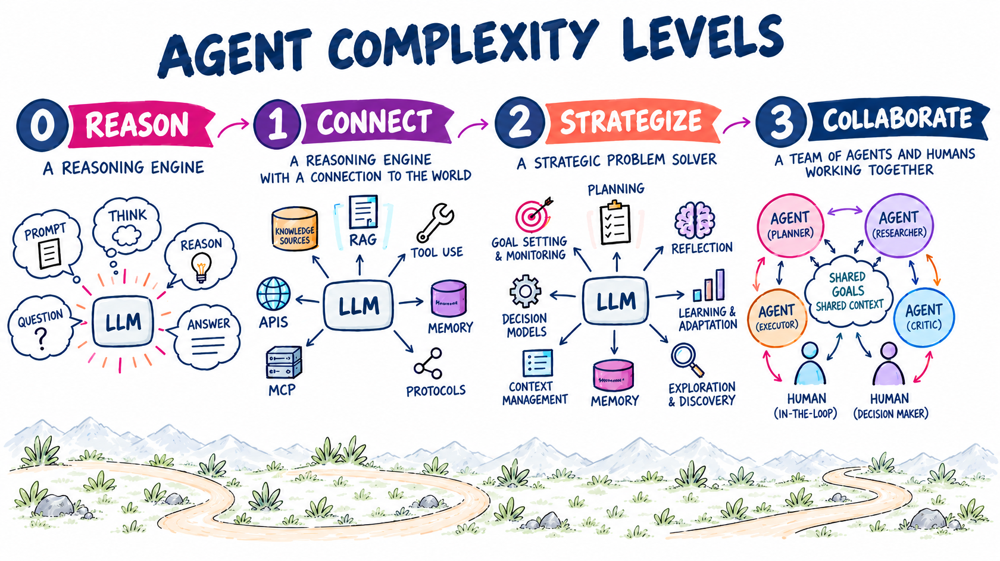
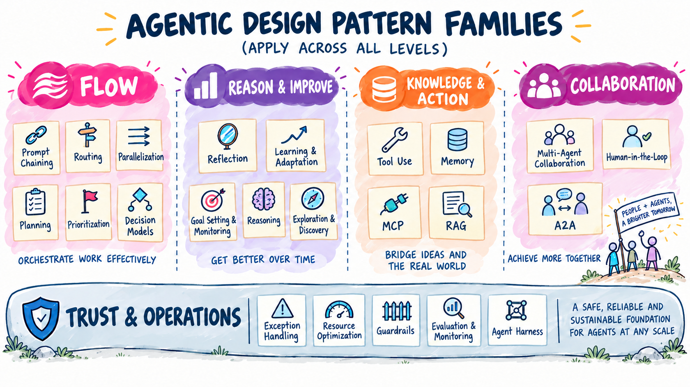
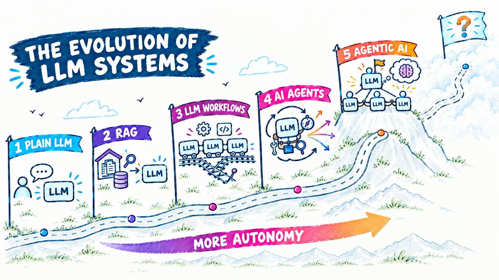

# Agentic design patterns and pattern families

This guide gives a common vocabulary for the C#/Microsoft Agent Framework demos in this repository. It summarises concepts from Antonio Gulli's *Agentic Design Patterns* (see [`book/`](../book)). The **five pattern families** are navigation metadata, not mandatory folder boundaries: patterns compose across families.

Start here for shared concepts, then explore one of the [five family guides](#pattern-guide-by-family). Each book pattern's family page links to an original figure in the included PDF by its printed figure number. The workflow visual summaries are independently drawn explanations, not reproductions of the book's artwork; the family opening illustrations are supplied presentation overviews.

- [Concepts versus executable demos](#concepts-versus-executable-demos)
- [What is an agentic system?](#what-is-an-agentic-system)
- [Levels of agent complexity](#levels-of-agent-complexity)
- [What is a design pattern?](#what-is-a-design-pattern)
- [Why cluster the patterns?](#why-cluster-the-patterns)
- [The five pattern families](#the-five-pattern-families)
- [Pattern guide by family](#pattern-guide-by-family)
- [Looking ahead](#looking-ahead)
- [Control before autonomy](#control-before-autonomy)
- [Composing patterns](#composing-patterns)
- [Mapping to Microsoft Agent Framework and Foundry](#mapping-to-microsoft-agent-framework-and-foundry)
- [Proposed contracts by family](#proposed-contracts-by-family)
- [Further reading](#further-reading)

## Concepts versus executable demos

Diagrams explain a pattern, not a promise that every capability is implemented by its console example. Solid arrows indicate execution or information flow; labeled alternatives are mutually exclusive; feedback only repeats while the stated budget remains. An exhausted budget is **not acceptance**. Protocol discovery is metadata, not a request sender or authorization grant. Broader conceptual loops are called out on the family pages and in the relevant diagram.

The [C# catalog](../dotnet/README.md#pattern-families) links to each runnable example and its optional companions. Read the pattern's **default** first; `all`, managed tools and hosting can require extra services and incur additional charges.

Each [family page](#pattern-guide-by-family) puts the executable **Demo contract** and its boundary next to the corresponding pattern, with a direct link to the C# demo.

Editable `.drawio` files are canonical; SVGs are local draw.io Desktop exports with embedded source. After editing, run `scripts\Export-Diagrams.ps1 -DrawioPath '<draw.io executable>'`, then visually inspect arrows, labels and stopping paths. `scripts\Test-Diagrams.ps1` checks XML/edge integrity and source hashes without requiring draw.io. It detects stale exports, not conceptual correctness.

## What is an agentic system?

An **agentic system** perceives its environment, decides what to do based on goals, and acts to reach those goals with some degree of autonomy. Traditional software follows a fixed script. An agent can interpret an ambiguous request, look things up, call other systems, ask clarifying questions, and adjust its next step based on what it observes.

The book describes recurring characteristics:

| Characteristic | Meaning |
|---|---|
| Autonomy | Acts without step-by-step human direction. |
| Goal orientation | Works towards an explicit objective rather than only answering a prompt. |
| Proactiveness and reactiveness | Takes initiative and responds to changes in its environment. |
| Tool use | Reaches beyond the model through APIs, databases, and services. |
| Memory | Retains information across steps and interactions. |
| Communication | Interacts with users, systems, and other agents. |

A practical way to picture an agent is a loop: **receive a goal → gather context → plan → act → observe and improve**. Each characteristic introduces engineering questions: how state is kept, when a tool is called, how agents coordinate, and how errors are recovered. Design patterns answer these questions.

## Levels of agent complexity

The book describes a spectrum of agent complexity. It helps to decide how much machinery a problem really needs.

| Level | Name | What it adds | Typical patterns |
|---|---|---|---|
| 0 | Core reasoning engine | An LLM answering only from its training data. No tools, memory, or environment access. | Prompting, reasoning |
| 1 | Connected problem-solver | External tools and retrieval, used across several steps. | Tool use, RAG, MCP |
| 2 | Strategic problem-solver | Planning, context engineering (selecting and packaging only the relevant information for each step), and self-improvement. | Planning, reflection, memory, goal monitoring, learning |
| 3 | Collaborative multi-agent system | A team of specialised agents coordinated like an organisation. | Multi-agent collaboration, A2A, human-in-the-loop |

This is a conceptual progression, not a required maturity ladder. Higher levels are not automatically better: each adds cost, latency, and failure modes. Start low and climb only when the problem requires it.



## What is a design pattern?

A design pattern is a **named, reusable solution to a recurring problem in a given context**. In classic software engineering, patterns such as Strategy or Observer give teams a shared language. Agentic design patterns do the same for systems built around language models. They are not rigid rules. They are proven templates that make agent logic easier to explain, review, test, and maintain.

The book presents each of its 21 patterns with the same anatomy, which the chapter READMEs in this repository follow:

| Element | Question it answers |
|---|---|
| Pattern overview | What problem does it solve, and how? |
| Practical applications | Where is it useful? |
| Hands-on example | What does a runnable implementation look like? Here, a C# port on Microsoft Agent Framework. |
| Key takeaways / at a glance | What, why, and the rule of thumb for when to apply it. |
| References | Where can I learn more? |

## Why cluster the patterns?

The book orders its chapters for learning, roughly from simple to advanced. The 21 patterns operate at different architectural levels, though. Some decide how work flows, some add capabilities, and some are production controls. A flat list of 21 items is hard to reason about when designing a system.

Grouping the patterns by the **architectural question they answer** gives a smaller mental model:

- Easier to choose: when you identify which question is unresolved, you can narrow the search to a handful of patterns.
- Easier to compose: real systems combine one or more patterns from several families.
- Easier to navigate: the catalog groups related demos while physical paths remain pattern-only.

Several groupings are possible: three architectural levels, six layers, or the book's own parts. I defined these **five families** as a teaching lens for this repository and its [research report](../ai-research/agentic-design-patterns-report-1.md), not as the book's chapter structure or an official MAF taxonomy. Families overlap in real systems; they do not dictate folder boundaries.

## The five pattern families



| # | Family | Guiding question | Patterns | Navigation |
|---|---|---|---|---|
| 1 | **[Flow](flow.md)** | How does work move through the system? | Prompt Chaining (1), Routing (2), Parallelization (3), Planning (6), Prioritization (20), *Decision Models* | [C# catalog](../dotnet/README.md#pattern-families) |
| 2 | **[Reason & Improve](reason-and-improve.md)** | How does the agent think about and improve its work? | Reflection (4), Learning & Adaptation (9), Goal Setting & Monitoring (11), Reasoning (17), Exploration & Discovery (21) | [C# catalog](../dotnet/README.md#pattern-families) |
| 3 | **[Knowledge & Action](knowledge-and-action.md)** | What does the agent know, and what can it do? | Tool Use (5), Memory (8), MCP (10), RAG (14) | [C# catalog](../dotnet/README.md#pattern-families) |
| 4 | **[Collaboration](collaboration.md)** | Who participates in the work? | Multi-Agent Collaboration (7), Human-in-the-Loop (13), A2A (15) | [C# catalog](../dotnet/README.md#pattern-families) |
| 5 | **[Trust & Operations](trust-and-operations.md)** | How does it stay safe, reliable, and affordable in production? | Exception Handling (12), Resource Optimization (16), Guardrails (18), Evaluation & Monitoring (19), *Agent Harness* | [C# catalog](../dotnet/README.md#pattern-families) |

Numbers in brackets are book chapters. Items in *italics* are repository additions beyond the book.

## Pattern guide by family

Choose a family to open its illustrated guide. Each page includes a pattern index, direct C# demo links, conceptual diagrams, executable boundaries and **Previous / Next** navigation through all 23 patterns.

| Family guide | Patterns |
|---|---|
| [Flow](flow.md) | [Prompt Chaining](flow.md#prompt-chaining-chapter-1), [Routing](flow.md#routing-chapter-2), [Parallelization](flow.md#parallelization-chapter-3), [Planning](flow.md#planning-chapter-6), [Prioritization](flow.md#prioritization-chapter-20), [Decision Models](flow.md#decision-models-repository-addition) |
| [Reason & Improve](reason-and-improve.md) | [Reflection](reason-and-improve.md#reflection-chapter-4), [Learning and Adaptation](reason-and-improve.md#learning-and-adaptation-chapter-9), [Goal Setting and Monitoring](reason-and-improve.md#goal-setting-and-monitoring-chapter-11), [Reasoning Techniques](reason-and-improve.md#reasoning-techniques-chapter-17), [Exploration and Discovery](reason-and-improve.md#exploration-and-discovery-chapter-21) |
| [Knowledge & Action](knowledge-and-action.md) | [Tool Use](knowledge-and-action.md#tool-use-chapter-5), [Memory Management](knowledge-and-action.md#memory-management-chapter-8), [Model Context Protocol](knowledge-and-action.md#model-context-protocol-mcp-chapter-10), [Knowledge Retrieval](knowledge-and-action.md#knowledge-retrieval-rag-chapter-14) |
| [Collaboration](collaboration.md) | [Multi-Agent Collaboration](collaboration.md#multi-agent-collaboration-chapter-7), [Human-in-the-Loop](collaboration.md#human-in-the-loop-hitl-chapter-13), [Inter-Agent Communication](collaboration.md#inter-agent-communication-a2a-chapter-15) |
| [Trust & Operations](trust-and-operations.md) | [Exception Handling and Recovery](trust-and-operations.md#exception-handling-and-recovery-chapter-12), [Resource-Aware Optimization](trust-and-operations.md#resource-aware-optimization-chapter-16), [Guardrails and Safety](trust-and-operations.md#guardrails-and-safety-chapter-18), [Evaluation and Monitoring](trust-and-operations.md#evaluation-and-monitoring-chapter-19), [Agent Harness](trust-and-operations.md#agent-harness-repository-addition) |

New here? Start with [Flow](flow.md); looking for operational controls? Jump to [Trust & Operations](trust-and-operations.md). Families are complementary perspectives, not a required sequence or exclusive classification.

## Looking ahead

The [enterprise backlog](../ai-research/agentic-patterns-backlog.md) is a selection guide, not a commitment to port more notebooks. Prefer a new pattern only when it adds a distinct, testable contract. Context lifecycle/verified handoff and governed memory writes are strong follow-on candidates; start with a small deterministic .NET core and an optional MAF adapter. [Context Management](https://agentic-design.ai/patterns/context-management) is a useful companion reading for selection, compaction, scope and lifecycle beyond immediate prompt wording.

The book also sketches possible directions rather than established capabilities: generalist agents for broad goals; personalized, proactive agents; embodied agents acting in the physical world; agent-driven economic activity; and goal-driven multi-agent systems that reshape their teams or instructions. Treat these as hypotheses about future systems, not evidence that the capabilities are reliable or ready for a given application.

## Control before autonomy

The central lesson of the research is **control before autonomy**. Start with the smallest controllable system and add autonomy only when evidence shows it is needed.



This illustration is a teaching lens, not a required roadmap or a claim that more
autonomy is better. Retrieval, workflows and agents can coexist; choose the smallest
architecture that meets the task's contract.

```text
One agent → typed tools → explicit limits → tracing → evaluation
```

A useful complexity progression is:

```text
Single agent
  → deterministic workflow            (Flow)
  → reflection / verification         (Reason & Improve)
  → routing / parallelization         (Flow)
  → planner–worker                    (Flow + Collaboration)
  → dynamic multi-agent system        (Collaboration)
```

Treat multi-agent architecture as an **optimisation for decomposition**, not a default. Trust & Operations controls should be in place before you move up the progression.

## Composing patterns

Real systems combine families. For example, a customer-support assistant might use:

1. **Guardrails** (Trust & Operations) to screen the incoming request.
2. **Routing** (Flow) to classify it as billing, technical, or general.
3. **RAG** and **Tool Use** (Knowledge & Action) to ground the answer and look up the order.
4. **Reflection** (Reason & Improve) to check the draft against policy.
5. **Human-in-the-Loop** (Collaboration) to approve refunds above a threshold.
6. **Exception Handling** and **Evaluation** (Trust & Operations) to recover from tool failures and track quality.

When designing, ask the five guiding questions in turn. Any question that has no clear answer points to the family to look at next.

## Mapping to Microsoft Agent Framework and Foundry

| Family | Microsoft Agent Framework building blocks | Microsoft Foundry capabilities |
|---|---|---|
| Flow | `WorkflowBuilder`, executors, conditional and switch edges, sequential and concurrent orchestration | Hosted agents, model deployments |
| Reason & Improve | Agent loops in workflows, structured output, middleware | Reasoning models, evaluation |
| Knowledge & Action | Function tools, MCP tools, context providers, agent sessions | Toolbox, MCP integration, file search, memory, Bing grounding |
| Collaboration | Handoff, group chat, Magentic orchestration, `RequestPort` for human input, A2A | Agent Service, A2A and Invocations protocols |
| Trust & Operations | Middleware, checkpoints, OpenTelemetry tracing, the agent harness | Guardrails and content safety, evaluation, tracing, Application Insights, identity |

The [.NET guide](../dotnet/README.md) lists every demo, hosted companion, and test project by family.

## Proposed contracts by family

The [enterprise backlog](../ai-research/agentic-patterns-backlog.md#backlog-by-pattern-family) uses these same families. Primary ownership follows the missing contract; related-family links show composition rather than duplicate work.

| Family | Primary backlog entries | Related entries |
|---|---|---|
| Flow | None | B02, B03, B10 |
| Reason & Improve | None | B09, B11 |
| Knowledge & Action | B04 Governed Skill Packages; B05 Context Lifecycle and Verified Handoff; B06 Memory Write and Lifecycle Governance | B01, B02, B07, B08 |
| Collaboration | None | B01, B03, B05, B08 |
| Trust & Operations | B01 Safe-Action Gateway; B02 Transactional Actuator; B03 Durable Reactive Agent; B07 Capability-Scoped Tool Authority; B08 Sandbox and Promote; B09 Trajectory Recording and Offline Replay; B10 Admission Control, Backpressure, and Bulkheads; B11 EvalOps and Controlled Rollout | B04, B05, B06 |

These are proposed contracts, not implemented demos. Empty primary categories reflect the backlog's enterprise focus, not a need to invent more patterns. The [taxonomy crosswalk and related notes](../ai-research/agentic-patterns-backlog.md#related-concepts-and-notes-for-existing-patterns) explain how the Avramovic catalog overlaps with this repository, including Fusion, Awareness, Spec-First, and completion controls.

## Further reading

- [Microsoft Agent Framework documentation](https://learn.microsoft.com/agent-framework/), [first agent](https://learn.microsoft.com/agent-framework/get-started/your-first-agent), [workflows](https://learn.microsoft.com/agent-framework/get-started/workflows), and [C# samples](https://github.com/microsoft/agent-framework/tree/main/dotnet/samples).
- [Context Management](https://agentic-design.ai/patterns/context-management).
- [`book/Agentic_Design_Patterns_Complete.md`](../book/Agentic_Design_Patterns_Complete.md) and the [PDF](../book/Agentic_Design_Patterns_Complete.pdf): the source book.
- [Agentic Design Patterns with Microsoft Foundry and Microsoft Agent Framework](../ai-research/agentic-design-patterns-report-1.md): the research report that defines the five families and the MAF/Foundry mapping.
- [Agent Harness pattern research](../ai-research/agent-harness-pattern.md): background for the enterprise extension.
