# Agentic design patterns and pattern families

This guide gives a common vocabulary for the demos in this repository. It summarises the basics of agentic systems and design patterns from Antonio Gulli's *Agentic Design Patterns* (see [`book/`](../book/)). It then introduces the **five pattern families** that the .NET solution is organised around.

Every book chapter has an original figure in the included PDF; each chapter below links to one by its printed figure number. The visual summaries in this guide are independently drawn explanations, not reproductions of the book's artwork.

- [What is an agentic system?](#what-is-an-agentic-system)
- [Levels of agent complexity](#levels-of-agent-complexity)
- [What is a design pattern?](#what-is-a-design-pattern)
- [Why cluster the patterns?](#why-cluster-the-patterns)
- [The five pattern families](#the-five-pattern-families)
- [Pattern guide by family](#pattern-guide-by-family)
- [Looking ahead](#looking-ahead)
- [Control before autonomy](#control-before-autonomy)
- [Composing patterns](#composing-patterns)
- [Mapping to Microsoft Agent Framework and Foundry](#mapping-to-microsoft-agent-framework-and-foundry)
- [Proposed contracts by family](#proposed-contracts-by-family)
- [Further reading](#further-reading)

## What is an agentic system?

An **agentic system** perceives its environment, decides what to do based on goals, and acts to reach those goals with some degree of autonomy. Traditional software follows a fixed script. An agent can interpret an ambiguous request, look things up, call other systems, ask clarifying questions, and adjust its next step based on what it observes.

The book describes recurring characteristics:

| Characteristic | Meaning |
|---|---|
| Autonomy | Acts without step-by-step human direction. |
| Goal orientation | Works towards an explicit objective rather than only answering a prompt. |
| Proactiveness and reactiveness | Takes initiative and responds to changes in its environment. |
| Tool use | Reaches beyond the model through APIs, databases, and services. |
| Memory | Retains information across steps and interactions. |
| Communication | Interacts with users, systems, and other agents. |

A practical way to picture an agent is a loop: **receive a goal → gather context → plan → act → observe and improve**. Each characteristic introduces engineering questions: how state is kept, when a tool is called, how agents coordinate, and how errors are recovered. Design patterns answer these questions.

## Levels of agent complexity

The book describes a spectrum of agent complexity. It helps to decide how much machinery a problem really needs.

| Level | Name | What it adds | Typical patterns |
|---|---|---|---|
| 0 | Core reasoning engine | An LLM answering only from its training data. No tools, memory, or environment access. | Prompting, reasoning |
| 1 | Connected problem-solver | External tools and retrieval, used across several steps. | Tool use, RAG, MCP |
| 2 | Strategic problem-solver | Planning, context engineering (selecting and packaging only the relevant information for each step), and self-improvement. | Planning, reflection, memory, goal monitoring, learning |
| 3 | Collaborative multi-agent system | A team of specialised agents coordinated like an organisation. | Multi-agent collaboration, A2A, human-in-the-loop |

This is a conceptual progression, not a required maturity ladder. Higher levels are not automatically better: each adds cost, latency, and failure modes. Start low and climb only when the problem requires it.

## What is a design pattern?

A design pattern is a **named, reusable solution to a recurring problem in a given context**. In classic software engineering, patterns such as Strategy or Observer give teams a shared language. Agentic design patterns do the same for systems built around language models. They are not rigid rules. They are proven templates that make agent logic easier to explain, review, test, and maintain.

The book presents each of its 21 patterns with the same anatomy, which the chapter READMEs in this repository follow:

| Element | Question it answers |
|---|---|
| Pattern overview | What problem does it solve, and how? |
| Practical applications | Where is it useful? |
| Hands-on example | What does a runnable implementation look like? Here, a C# port on Microsoft Agent Framework. |
| Key takeaways / at a glance | What, why, and the rule of thumb for when to apply it. |
| References | Where can I learn more? |

## Why cluster the patterns?

The book orders its chapters for learning, roughly from simple to advanced. The 21 patterns operate at different architectural levels, though. Some decide how work flows, some add capabilities, and some are production controls. A flat list of 21 items is hard to reason about when designing a system.

Grouping the patterns by the **architectural question they answer** gives a smaller mental model:

- Easier to choose: when you identify which question is unresolved, you can narrow the search to a handful of patterns.
- Easier to compose: real systems combine one or more patterns from several families.
- Easier to navigate: the .NET solution mirrors the families, so related demos sit next to each other.

Several groupings are possible: three architectural levels, six layers, or the book's own parts. This repository uses the **five families** from the research report [Agentic Design Patterns with Microsoft Foundry and Microsoft Agent Framework](../ai-research/agentic-design-patterns-report-1.md). They are memorable, map one-to-one to folders, and suit teaching.

## The five pattern families

| # | Family | Guiding question | Patterns | Folder |
|---|---|---|---|---|
| 1 | **Flow** | How does work move through the system? | Prompt Chaining (1), Routing (2), Parallelization (3), Planning (6), Prioritization (20), *Decision Models* | [`dotnet/src/01-Flow`](../dotnet/src/01-Flow/README.md) |
| 2 | **Reason & Improve** | How does the agent think about and improve its work? | Reflection (4), Learning & Adaptation (9), Goal Setting & Monitoring (11), Reasoning (17), Exploration & Discovery (21) | [`dotnet/src/02-ReasonAndImprove`](../dotnet/src/02-ReasonAndImprove/README.md) |
| 3 | **Knowledge & Action** | What does the agent know, and what can it do? | Tool Use (5), Memory (8), MCP (10), RAG (14) | [`dotnet/src/03-KnowledgeAndAction`](../dotnet/src/03-KnowledgeAndAction/README.md) |
| 4 | **Collaboration** | Who participates in the work? | Multi-Agent Collaboration (7), Human-in-the-Loop (13), A2A (15) | [`dotnet/src/04-Collaboration`](../dotnet/src/04-Collaboration/README.md) |
| 5 | **Trust & Operations** | How does it stay safe, reliable, and affordable in production? | Exception Handling (12), Resource Optimization (16), Guardrails (18), Evaluation & Monitoring (19), *Agent Harness* | [`dotnet/src/05-TrustAndOperations`](../dotnet/src/05-TrustAndOperations/README.md) |

Numbers in brackets are book chapters. Items in *italics* are repository additions beyond the book.

### 1. Flow

Flow patterns define the **shape of execution**: the step order, which branch runs, what runs concurrently, and what comes first.

- **Use when** a task has identifiable steps or categories, independent sub-tasks, or competing work items.
- **Watch for** serial latency in chains, misrouting, and aggregation conflicts after fan-out. Unbounded plans are another risk.
- **Repository note:** Decision Models belongs here. It supplies typed, calibrated decisions that drive routing, ranking, and gating.

### 2. Reason & Improve

These patterns spend extra inference to **raise the quality** of an answer. They use structured reasoning, critique-and-revise loops, explicit goals, feedback-driven adaptation, and hypothesis exploration.

- **Use when** correctness or quality matters more than latency, and success criteria can be stated.
- **Watch for** loops without stop conditions, a critic that shares the generator's blind spots, and rising cost.

### 3. Knowledge & Action

These patterns connect the model to the world. They **ground** it in data through RAG and memory, and let it **act** through tools and MCP.

- **Use when** the answer depends on private, current, or remembered information, or when the agent must change state in another system.
- **Watch for** irrelevant retrieval, stale memory, and over-broad tools. Every tool expands the attack surface.

### 4. Collaboration

Collaboration patterns distribute work across **multiple actors**. These can be specialised agents, remote agents reached over a protocol, or people who approve and correct.

- **Use when** the problem decomposes into roles with different instructions, tools, or models, or when a decision needs human accountability.
- **Watch for** coordination overhead, lost context between agents, and approval fatigue.

### 5. Trust & Operations

These patterns turn an agent into a **production system**. They bound behaviour, recover from failures, control cost, measure quality, and package the runtime.

- **Use when** always, in proportion to risk. This family applies to every other family.
- **Repository note:** Agent Harness, an enterprise extension, belongs here because it packages operational controls (todos, bounded tools, compaction, tracing, and completion checks) around an agent.

## Pattern guide by family

The chapters below expand the family summaries with the practical distinctions, decision rules, and trade-offs that help when selecting and combining patterns. The chapter numbers refer to Antonio Gulli's *Agentic Design Patterns*; Decision Models and Agent Harness are repository additions.

### 1. Flow

Flow patterns define a workflow's execution shape: what runs, in what order, and under which conditions.

#### Prompt Chaining (Chapter 1)

Also called the **Pipeline pattern**, prompt chaining decomposes a task into focused stages and passes each stage's result to the next. It is easier to inspect and debug than a monolithic prompt, and stages can include tools or external systems as well as model calls. Structured outputs, such as validated JSON, make stage boundaries and handoffs explicit.

Use it when the task has distinct, mostly known stages; prefer a fixed workflow over a planner when the path is repeatable. Context engineering—the selection of instructions, retrieved knowledge, tool results, state, and memory—is broader than prompt engineering, which focuses on phrasing the immediate instruction.

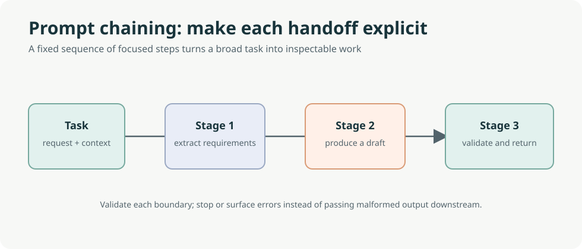

Editable diagram: [prompt-chaining-visual-summary.drawio](images/prompt-chaining-visual-summary.drawio).

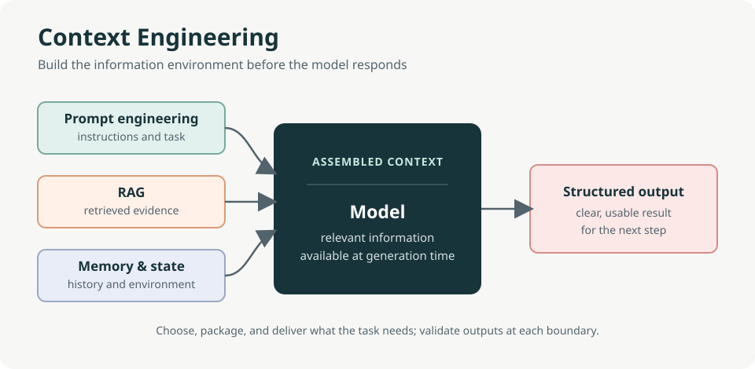

Editable diagram: [context-engineering.drawio](images/context-engineering.drawio).

Original book illustration: [Figure 32.1](../book/Agentic_Design_Patterns_Complete.pdf).

#### Routing (Chapter 2)

Routing chooses a tool, function, workflow, or specialist based on the request or current state. The decision can be **rule-based** (explicit fields or conditions), **embedding-based** (semantic similarity to route examples), **classifier-based** (a trained model), or **LLM-based** (a generative model chooses a route). It can run at intake, between workflow stages, or inside a subroutine.

Use routing when different inputs genuinely need different paths. Define route boundaries and a clarification or safe fallback for uncertain cases; semantic similarity and a plausible model-selected label are not proof that the route is correct.

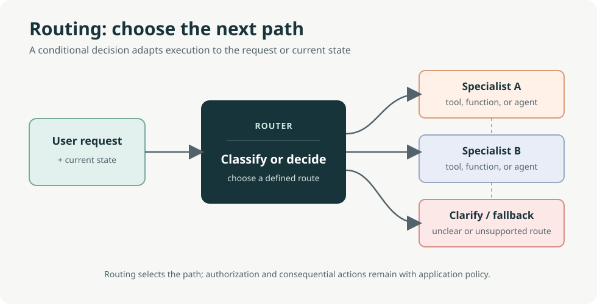

Editable diagram: [routing-visual-summary.drawio](images/routing-visual-summary.drawio).

Original book illustration: [Figure 46.1](../book/Agentic_Design_Patterns_Complete.pdf).

#### Parallelization (Chapter 3)

Parallelization runs independent model calls, tools, or agents concurrently, then joins their results before dependent work proceeds. It is useful for independent analyses, separate data chunks, or slow external calls. It does not remove dependencies: a step that needs another step's output must wait.

Use it when the work can safely be split. Define how to handle partial failures and reconcile conflicting results, and measure end-to-end benefit against coordination overhead and resource use.

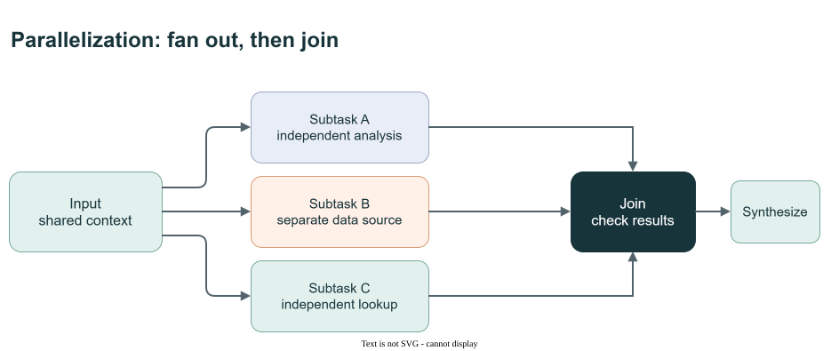

Editable diagram: [parallelization-visual-summary.drawio](images/parallelization-visual-summary.drawio).

Original book illustration: [Figure 49.1](../book/Agentic_Design_Patterns_Complete.pdf).

#### Planning (Chapter 6)

Planning turns an initial state and goal into an ordered set of actions, managing dependencies and adapting as results or constraints change. It is most useful when the **how** must be discovered—for example, an investigation whose next research step depends on evidence found so far. If the steps are already known and repeatable, use a fixed workflow instead.

Give plans explicit success criteria, bounded steps, and a stopping condition. Verify completion against observable evidence rather than accepting the planner's own claim that the goal is done.

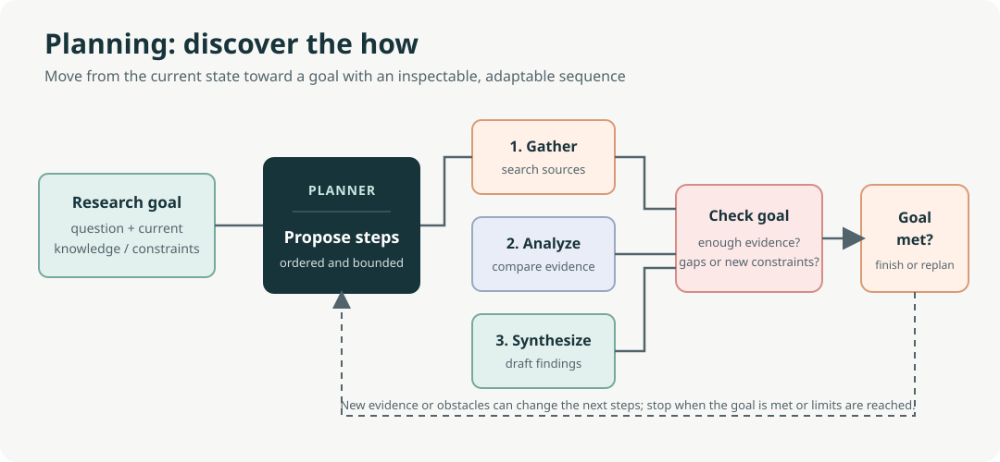

Editable diagram: [planning-visual-summary.drawio](images/planning-visual-summary.drawio).

Original book illustration: [Figure 102.1](../book/Agentic_Design_Patterns_Complete.pdf).

#### Prioritization (Chapter 20)

Prioritization ranks or schedules competing goals, tasks, and next actions against urgency, importance, dependencies, resources, cost/benefit, and user preferences. Priorities may be reassessed as deadlines, events, or resource conditions change, at strategic, plan, or immediate-action level.

Use it when an agent must choose among competing work under constraints. The agent may adjust execution focus within delegated authority, but changing the approved objective or hard constraints requires authorization.

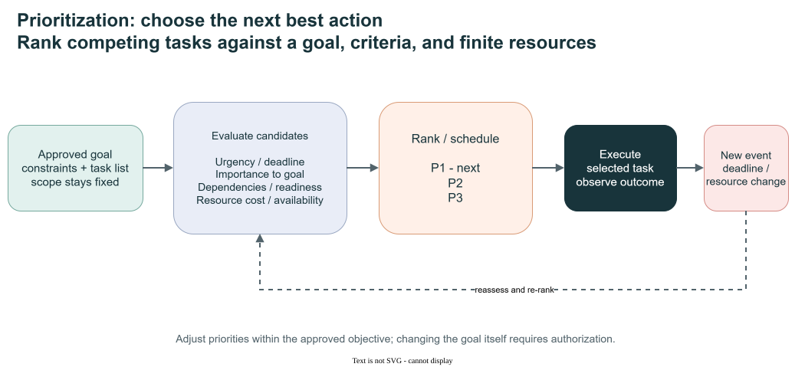

Editable diagram: [prioritization-visual-summary.drawio](images/prioritization-visual-summary.drawio).

Original book illustration: [Figure 329.1](../book/Agentic_Design_Patterns_Complete.pdf).

#### Decision Models (Repository addition)

Decision Models provide typed, calibrated decisions that can drive routing, ranking, or gating. Keep decision criteria explicit and validate outputs before using them to change control flow.

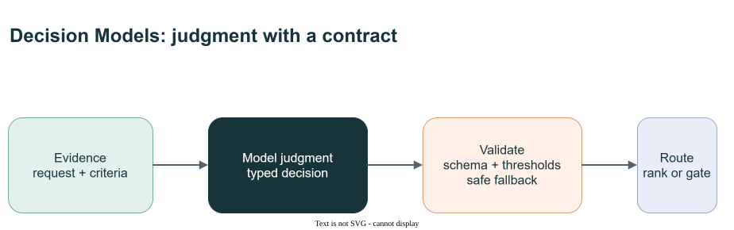

Editable diagram: [decision-models-visual-summary.drawio](images/decision-models-visual-summary.drawio).

### 2. Reason & Improve

These patterns add inference or feedback to improve the quality of decisions and outputs. The additional calls and exploration can increase latency and cost, so use measurable criteria and stop conditions.

#### Reflection (Chapter 4)

Reflection is a feedback loop: create a draft, critique it against criteria, decide how to address the gaps, then refine or stop. A single agent can review its own work, or a separate critic can divide the roles. A separate critic may bring a different perspective, but does not guarantee objectivity; both approaches add inference cost.

Use it when correctness or quality matters more than a single-pass response's speed. Set a bounded number of iterations and criteria the application can evaluate.


Editable diagram: [reflection-visual-summary.drawio](images/reflection-visual-summary.drawio).

Original book illustration: [Figure 73.1](../book/Agentic_Design_Patterns_Complete.pdf).

#### Learning and Adaptation (Chapter 9)

Learning and adaptation cover mechanisms that change knowledge, behaviour, or strategy from data and experience, from supervised or reinforcement learning to memory-based adaptation and evolutionary self-improvement. These mechanisms are not interchangeable: model parameter updates, in-context adaptation, retrieval from memory, and an agent modifying its own code have different risks and evaluation needs.

Consider this pattern in dynamic environments that require continual improvement or personalization. Verify the evidence and evaluation setup behind performance claims—including examples such as SICA, AlphaEvolve, and OpenEvolve—and distinguish measured outcomes from broader claims. Sandbox self-modification and provide human oversight, rollback, and independent tests before granting it greater autonomy.


Editable diagram: [learning-adaptation-visual-summary.drawio](images/learning-adaptation-visual-summary.drawio).

Original book illustration: [Figure 156.1](../book/Agentic_Design_Patterns_Complete.pdf).

#### Goal Setting and Monitoring (Chapter 11)

Explicit goals turn a broad objective into intermediate steps and observable success criteria. Monitoring checks whether actions are advancing the goal and whether circumstances have changed enough to adapt or replan.

Use it for multi-step work with a defined outcome. A model's judgment that it has finished is not evidence of success; check outcomes independently wherever they matter.


Editable diagram: [goal-setting-monitoring-visual-summary.drawio](images/goal-setting-monitoring-visual-summary.drawio).

Original book illustration: [Figure 188.1](../book/Agentic_Design_Patterns_Complete.pdf).

#### Reasoning Techniques (Chapter 17)

Reasoning techniques structure multi-step problem solving. **Chain-of-Thought** organizes intermediate steps; **Tree-of-Thought** explores and prunes alternatives; **self-refinement** critiques and revises; **program-aided reasoning** delegates deterministic calculation to code; **ReAct** interleaves reasoning, tool actions, and observations; and **self-consistency** compares multiple candidate answers. Debate, graph-of-debate, and deep-research approaches structure multi-perspective review or iterative search. **MASS** searches over agent roles, workflow topology, and prompts.

Choose the simplest technique that fits the task and evaluate the result. More inference-time computation can help on some tasks, but increases latency and cost and does not guarantee correctness. A generated rationale is not necessarily a faithful record of hidden reasoning or proof that an answer is right.


Editable diagram: [reasoning-techniques-overview.drawio](images/reasoning-techniques-overview.drawio).

Original book illustration: [Figure 262.1](../book/Agentic_Design_Patterns_Complete.pdf).

#### Exploration and Discovery (Chapter 21)

Exploration seeks new information, possibilities, or hypotheses when the solution space is not fully known. A useful cycle is to generate candidates, critique and rank them, investigate the strongest candidates, then refine or discard them using evidence. Specialized roles can divide generation, ranking, investigation, and synthesis.

Use it for open-ended discovery, not merely execution of a known plan. Treat generated hypotheses as candidates—not findings—and validate them against reliable sources, benchmarks, or experiments. Incomplete sources, hallucinations, sparse negative results, and the compute required to test possibilities limit what exploration can establish.


Editable diagram: [exploration-discovery-visual-summary.drawio](images/exploration-discovery-visual-summary.drawio).

Original book illustration: [Figure 335.1](../book/Agentic_Design_Patterns_Complete.pdf).

### 3. Knowledge & Action

These patterns connect an agent to information and capabilities beyond its model context. Retrieval can ground an answer, but neither a retrieved result nor a tool response is automatically authoritative or safe.

#### Tool Use (Chapter 5)

The model considers available tools and may request a structured call. The orchestration layer validates and dispatches that request; the result returns as an observation that can inform the answer or another bounded action. Tool use supports current or private information, precise calculations, code execution, and changes in external systems.

Treat tool descriptions and arguments as an interface contract. Validate calls and results, apply least privilege and authorization in the application, and make consequential actions explicit and reviewable.

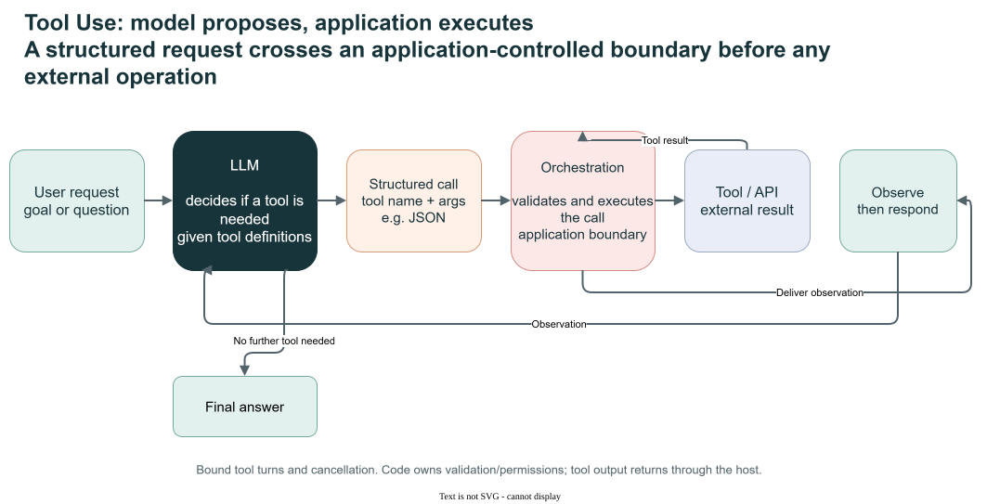

Editable diagram: [tool-use-visual-summary.drawio](images/tool-use-visual-summary.drawio).

Original book illustration: [Figure 80.1](../book/Agentic_Design_Patterns_Complete.pdf).

#### Memory Management (Chapter 8)

**Short-term memory** is the active conversation state—recent messages, tool results, and reflections—held in a limited context window. Compaction summarizes older context to retain useful information, but remains temporary and session-scoped. **Long-term memory** persists outside that context, for example in a database or knowledge store, and is retrieved when relevant.

Use memory when continuity, task progress, history, or personalization matters. Decide what should persist, how it is retrieved and updated, and how privacy, staleness, and deletion are handled.

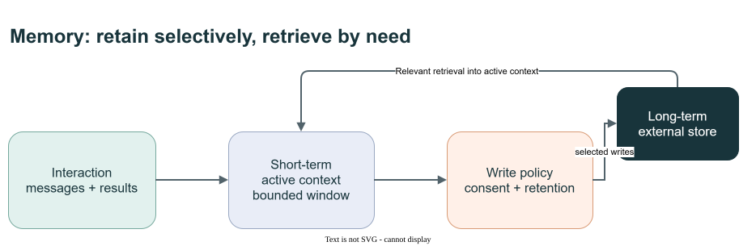

Editable diagram: [memory-management-visual-summary.drawio](images/memory-management-visual-summary.drawio).

Original book illustration: [Figure 149.1](../book/Agentic_Design_Patterns_Complete.pdf).

#### Model Context Protocol (MCP, Chapter 10)

MCP standardizes communication between an AI application (host), its MCP clients, and MCP servers. Servers can expose tools, resources, and prompts; the host controls how these capabilities are presented to a model and used. MCP and model function calling operate at different layers and can be composed: the model requests a call, the host validates it, and an MCP client can dispatch it to a server.

Use MCP when interoperability, discovery, or reuse across independently maintained servers justifies the protocol. A small application with a few fixed in-process functions may be simpler without it. MCP does not provide orchestration, authorization policy, or a guarantee that a server's capability is safe. Configure compatible clients, transports, authentication, and permissions, then validate each tool's inputs and effects.

Reference: [MCP Architecture Overview](https://modelcontextprotocol.io/docs/2026-07-28/learn/architecture).

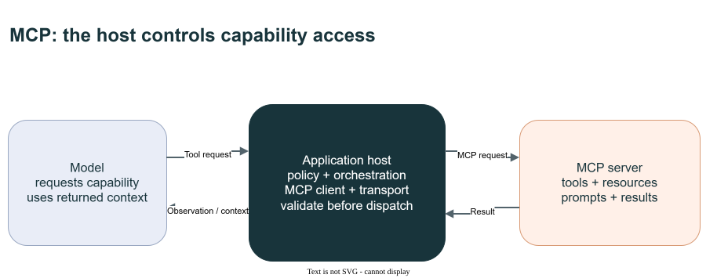

Editable diagram: [mcp-visual-summary.drawio](images/mcp-visual-summary.drawio).

Original book illustration: [Figure 177.1](../book/Agentic_Design_Patterns_Complete.pdf).

#### Knowledge Retrieval (RAG, Chapter 14)

Retrieval-augmented generation searches external sources and adds selected evidence to the model's context. Embeddings support semantic search; hybrid search combines semantic and keyword retrieval; reranking can reorder candidates at extra compute and latency cost. Chunking, metadata, provenance, and index freshness determine whether relevant evidence can be found with its qualifications intact.

A more agentic retrieval flow can retrieve candidates, validate source relevance and authority, decompose complex questions, reconcile conflicts, identify gaps, and synthesize a cited answer. Preserve query-to-source links and disclose gaps or abstain when evidence is insufficient.

Common failure modes include missing or noisy retrieval, fragmented evidence, stale or conflicting sources, context lost at chunk boundaries, and unbounded tool loops. Retrieval and citations reduce some grounding problems but cannot guarantee factual accuracy, completeness, or currentness; evaluate retrieval and answer quality and account for the added latency and cost.

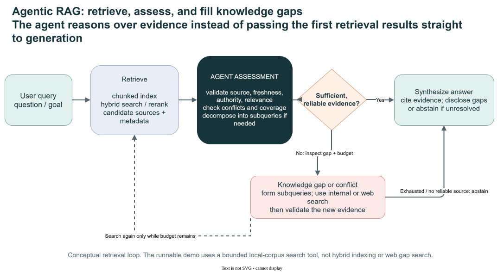

Editable diagram: [agentic-rag-visual-summary.drawio](images/agentic-rag-visual-summary.drawio).

Original book illustration: [Figure 213.1](../book/Agentic_Design_Patterns_Complete.pdf).

### 4. Collaboration

Collaboration distributes work among actors. Add it when distinct roles or accountability improve outcomes enough to justify handoffs, coordination, and additional failure modes.

#### Multi-Agent Collaboration (Chapter 7)

Agents with distinct roles, tools, or knowledge can collaborate through sequential handoffs, parallel sub-tasks, debate, hierarchical delegation, expert teams, or critic-reviewer cycles. Common structures include peer networks, a central supervisor, a supervisor consulted as a tool, and multi-level hierarchies. These structures can be combined; they are options rather than a fixed taxonomy.

Use collaboration when a task decomposes into parts that benefit from specialization or parallel work. Choose a structure based on task complexity, team size, desired autonomy, and robustness needs. Account for coordination overhead, context loss, bottlenecks, and clear responsibility for the final result.

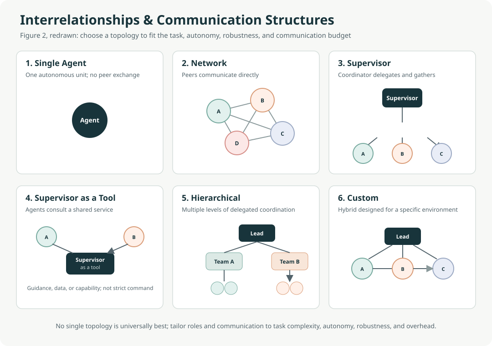

Editable diagram: [multi-agent-structures.drawio](images/multi-agent-structures.drawio).

Original book illustration: [Figure 113.1](../book/Agentic_Design_Patterns_Complete.pdf).

#### Human-in-the-Loop (HITL, Chapter 13)

People can supply missing context, correct errors, review outputs, or approve, reject, and redirect consequential actions. Human review is particularly important for high-risk, ambiguous, or policy-sensitive decisions; use a qualified reviewer when the decision requires specialist judgment.

Define who reviews, what information they need, what approval or rejection does to the workflow, and when the system must stop or escalate. Balance safety and accountability against review latency and throughput, and minimize or anonymize sensitive information shown to reviewers.

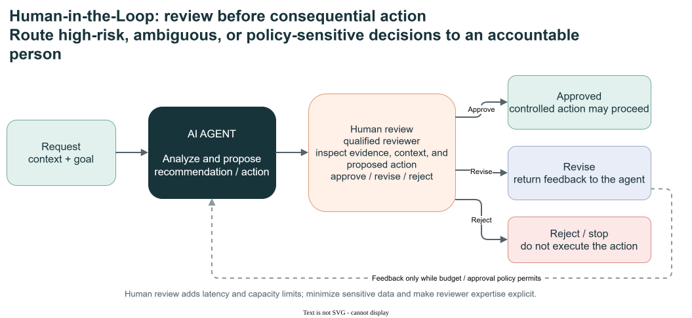

Editable diagram: [human-in-the-loop-visual-summary.drawio](images/human-in-the-loop-visual-summary.drawio).

Original book illustration: [Figure 209.1](../book/Agentic_Design_Patterns_Complete.pdf).

#### Inter-Agent Communication (A2A, Chapter 15)

A2A is a protocol for communication and collaboration between agents built with different frameworks; it complements MCP, which standardizes agent-to-tool and context access. An Agent Card describes an agent's identity, endpoint, skills, capabilities, input/output modes, and authentication requirements. Tasks track units of work and their lifecycle; messages and parts carry content, while artifacts represent deliverables. Interaction can include request/response, polling, streaming, or push notifications where supported.

Use A2A when independently built or deployed agents must collaborate across process or framework boundaries. For components within one application, a local workflow or framework-native handoff is often simpler. Protect discovery and endpoints, declare authentication requirements, and never put secrets in an Agent Card.

Reference: [A2A Protocol Documentation](https://a2a-protocol.org/latest/).

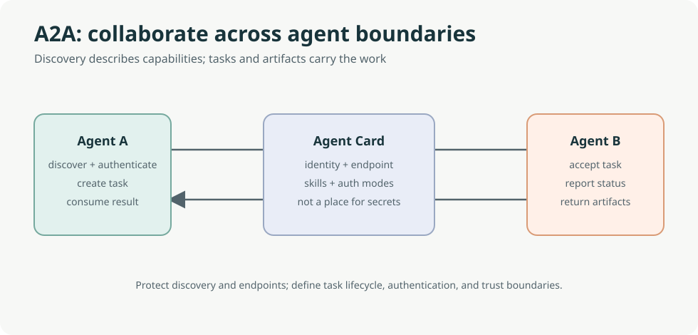

Editable diagram: [a2a-visual-summary.drawio](images/a2a-visual-summary.drawio).

Original book illustration: [Figure 234.1](../book/Agentic_Design_Patterns_Complete.pdf).

### 5. Trust & Operations

Trust and operational controls apply across every family. Select controls in proportion to impact and risk, and validate them against failures and changing conditions.

#### Exception Handling and Recovery (Chapter 12)

Resilience has three parts: **detect** failures and anomalies such as exceptions, timeouts, status errors, or malformed results; **handle** them through classification, logging, bounded retries for safe repeatable operations, fallback, or clear notification; and **recover** through rollback, diagnosis, correction, or replanning. Escalate or fail explicitly when recovery would be unsafe or unsuccessful.

Plan failure paths whenever tools or external systems are involved. Avoid unbounded retries and silent degradation; define when partial service is acceptable and what the user or operator must be told.

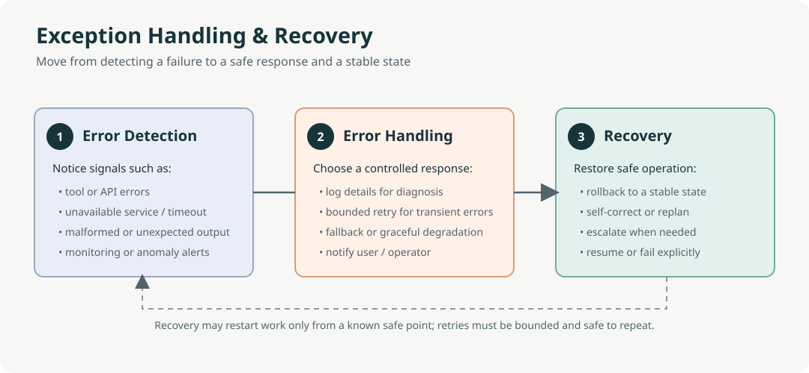

Editable diagram: [exception-recovery-visual-summary.drawio](images/exception-recovery-visual-summary.drawio).

Original book illustration: [Figure 195.1](../book/Agentic_Design_Patterns_Complete.pdf).

#### Resource-Aware Optimization (Chapter 16)

Resource optimization balances quality against explicit compute, time, energy, and financial budgets. Options include selecting models or tools by task needs, pruning or summarizing context, predicting capacity, scheduling parallel work, and degrading gracefully when preferred resources are unavailable.

Use it when resource limits matter, particularly when tasks have different needs. Measure quality, latency, and cost on representative work before claiming that a model-switching or allocation policy improves efficiency; a cheaper or faster path may also reduce quality.

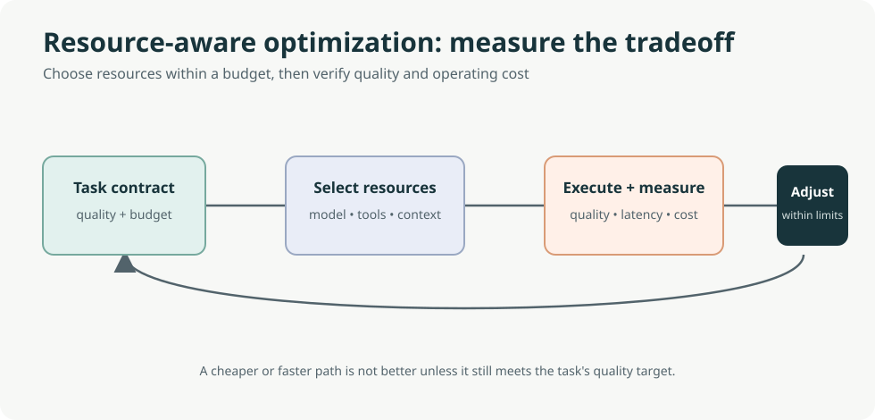

Editable diagram: [resource-optimization-visual-summary.drawio](images/resource-optimization-visual-summary.drawio).

Original book illustration: [Figure 255.1](../book/Agentic_Design_Patterns_Complete.pdf).

#### Guardrails and Safety (Chapter 18)

Use defense in depth: validate inputs, minimize or anonymize personal information, constrain behavior, restrict tools and permissions, check outputs, and escalate critical or ambiguous cases to people. Apply least privilege so each agent has only the data and capabilities its task requires. Structured logs of tool calls, outcomes, policy decisions, errors, and metrics support investigation; they are not a substitute for controls, and logs need access, retention, and data-minimization policies of their own.

Test normal, edge, and adversarial inputs, and combine independent safeguards rather than relying on prompts alone. Use checkpoints and rollback where recovery from an off-course action is needed.

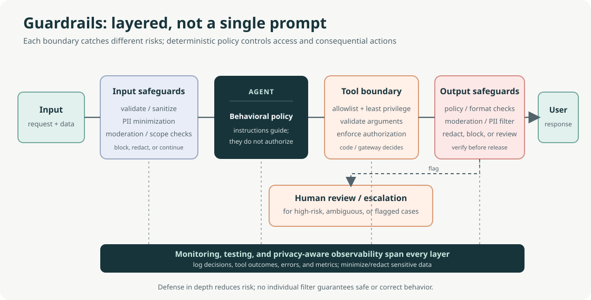

Editable diagram: [guardrails-defense-in-depth.drawio](images/guardrails-defense-in-depth.drawio).

Original book illustration: [Figure 302.1](../book/Agentic_Design_Patterns_Complete.pdf).

#### Evaluation and Monitoring (Chapter 19)

**Evaluation** measures whether outputs, actions, and workflows meet defined goals; **monitoring** tracks quality and operational health after deployment so drift, anomalies, and regressions can be detected. Combine deterministic checks, task-specific metrics, calibrated model judges, and human evaluation as appropriate. For tool-using systems, assess trajectories too: tool choice, arguments, action ordering, dependencies, and handoffs.

Monitor response quality, end-to-end and per-step latency, token usage and cost, task completion, user feedback, errors, retries, resource use, and drift. In multi-agent systems, measure both specialist and end-to-end performance, including handoff quality and attribution. Exact trajectory matching can reject valid alternative paths; overly permissive matching can miss harmful detours.

Use representative, maintained evaluation sets and A/B tests to assess changes. A task contract—deliverables, scope, sources, constraints, budget, and acceptance criteria—can make expectations more explicit, but is a design approach rather than a standardized protocol. No single score, including an LLM judge or rubric, should be treated as a complete safety gate.

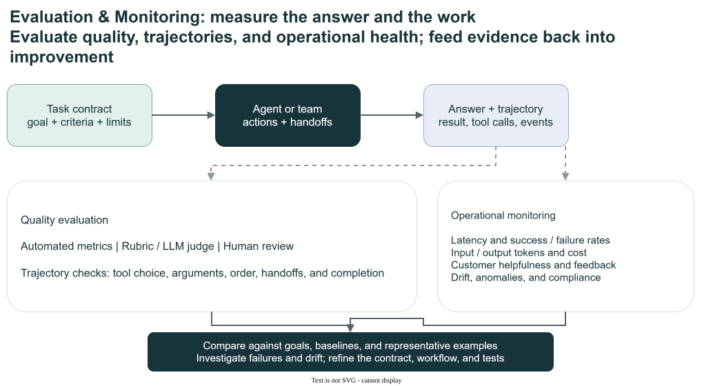

Editable diagram: [evaluation-monitoring-visual-summary.drawio](images/evaluation-monitoring-visual-summary.drawio).

Original book illustration: [Figure 304.1](../book/Agentic_Design_Patterns_Complete.pdf).

## Looking ahead

The book also sketches possible directions rather than established capabilities: generalist agents for broad goals; personalized, proactive agents; embodied agents acting in the physical world; agent-driven economic activity; and goal-driven multi-agent systems that reshape their teams or instructions. Treat these as hypotheses about future systems, not evidence that the capabilities are reliable or ready for a given application.

## Control before autonomy

The central lesson of the research is **control before autonomy**. Start with the smallest controllable system and add autonomy only when evidence shows it is needed.

```text
One agent → typed tools → explicit limits → tracing → evaluation
```

A useful complexity progression is:

```text
Single agent
  → deterministic workflow            (Flow)
  → reflection / verification         (Reason & Improve)
  → routing / parallelization         (Flow)
  → planner–worker                    (Flow + Collaboration)
  → dynamic multi-agent system        (Collaboration)
```

Treat multi-agent architecture as an **optimisation for decomposition**, not a default. Trust & Operations controls should be in place before you move up the progression.

## Composing patterns

Real systems combine families. For example, a customer-support assistant might use:

1. **Guardrails** (Trust & Operations) to screen the incoming request.
2. **Routing** (Flow) to classify it as billing, technical, or general.
3. **RAG** and **Tool Use** (Knowledge & Action) to ground the answer and look up the order.
4. **Reflection** (Reason & Improve) to check the draft against policy.
5. **Human-in-the-Loop** (Collaboration) to approve refunds above a threshold.
6. **Exception Handling** and **Evaluation** (Trust & Operations) to recover from tool failures and track quality.

When designing, ask the five guiding questions in turn. Any question that has no clear answer points to the family to look at next.

## Mapping to Microsoft Agent Framework and Foundry

| Family | Microsoft Agent Framework building blocks | Microsoft Foundry capabilities |
|---|---|---|
| Flow | `WorkflowBuilder`, executors, conditional and switch edges, sequential and concurrent orchestration | Hosted agents, model deployments |
| Reason & Improve | Agent loops in workflows, structured output, middleware | Reasoning models, evaluation |
| Knowledge & Action | Function tools, MCP tools, context providers, agent sessions | Toolbox, MCP integration, file search, memory, Bing grounding |
| Collaboration | Handoff, group chat, Magentic orchestration, `RequestPort` for human input, A2A | Agent Service, A2A and Invocations protocols |
| Trust & Operations | Middleware, checkpoints, OpenTelemetry tracing, the agent harness | Guardrails and content safety, evaluation, tracing, Application Insights, identity |

The [.NET guide](../dotnet/README.md) lists every demo, hosted companion, and test project by family.

## Proposed contracts by family

The [enterprise backlog](../ai-research/agentic-patterns-backlog.md#backlog-by-pattern-family) uses these same families. Primary ownership follows the missing contract; related-family links show composition rather than duplicate work.

| Family | Primary backlog entries | Related entries |
|---|---|---|
| Flow | None | B02, B03, B10 |
| Reason & Improve | None | B09, B11 |
| Knowledge & Action | B04 Governed Skill Packages; B05 Context Lifecycle and Verified Handoff; B06 Memory Write and Lifecycle Governance | B01, B02, B07, B08 |
| Collaboration | None | B01, B03, B05, B08 |
| Trust & Operations | B01 Safe-Action Gateway; B02 Transactional Actuator; B03 Durable Reactive Agent; B07 Capability-Scoped Tool Authority; B08 Sandbox and Promote; B09 Trajectory Recording and Offline Replay; B10 Admission Control, Backpressure, and Bulkheads; B11 EvalOps and Controlled Rollout | B04, B05, B06 |

These are proposed contracts, not implemented demos. Empty primary categories reflect the backlog's enterprise focus, not a need to invent more patterns. The [taxonomy crosswalk and related notes](../ai-research/agentic-patterns-backlog.md#related-concepts-and-notes-for-existing-patterns) explain how the Avramovic catalog overlaps with this repository, including Fusion, Awareness, Spec-First, and completion controls.

## Further reading

- [`book/Agentic_Design_Patterns_Complete.md`](../book/Agentic_Design_Patterns_Complete.md) and the [PDF](../book/Agentic_Design_Patterns_Complete.pdf): the source book.
- [Agentic Design Patterns with Microsoft Foundry and Microsoft Agent Framework](../ai-research/agentic-design-patterns-report-1.md): the research report that defines the five families and the MAF/Foundry mapping.
- [Agent Harness pattern research](../ai-research/agent-harness-pattern.md): background for the enterprise extension.
