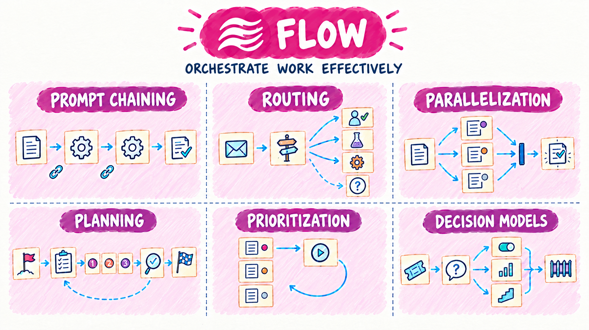
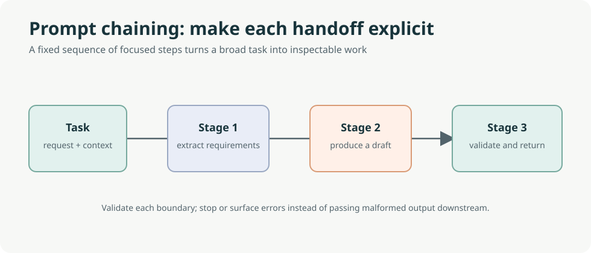
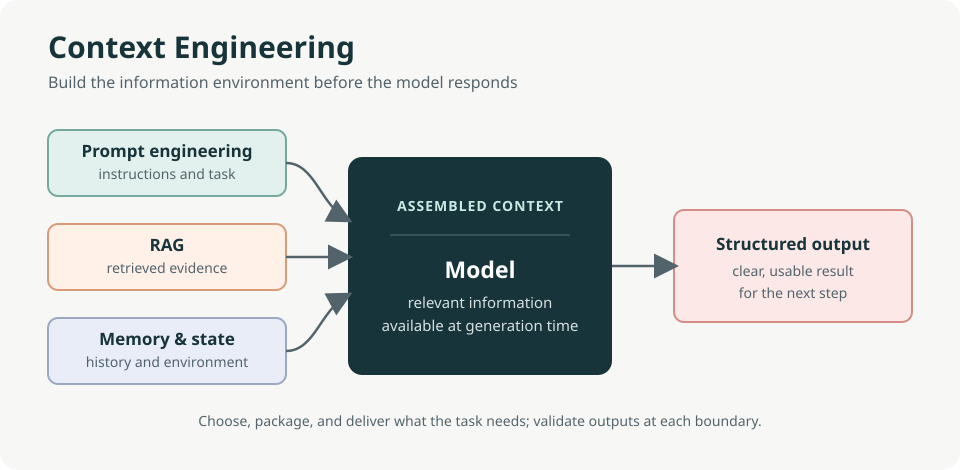
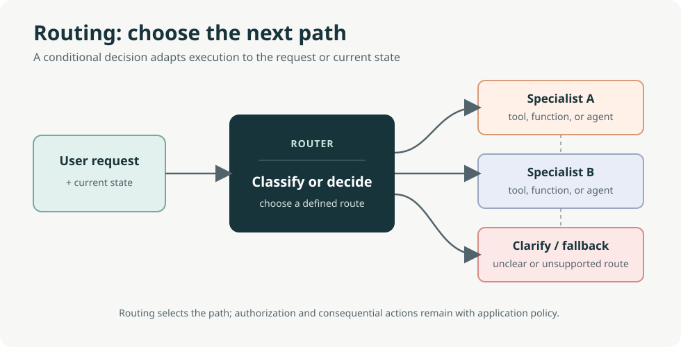
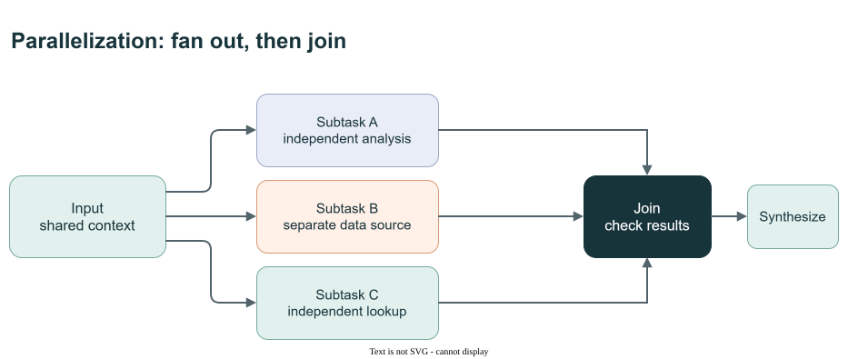
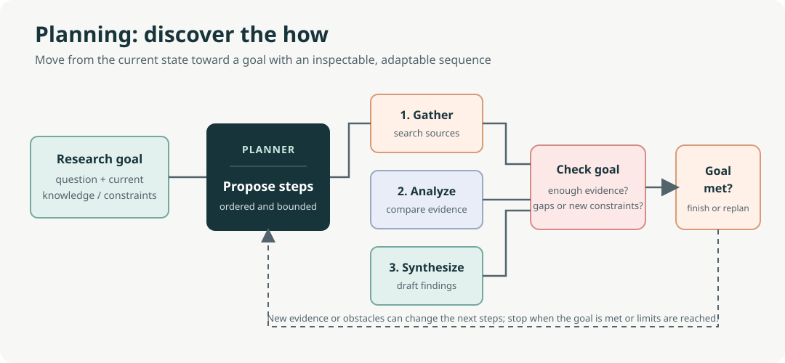
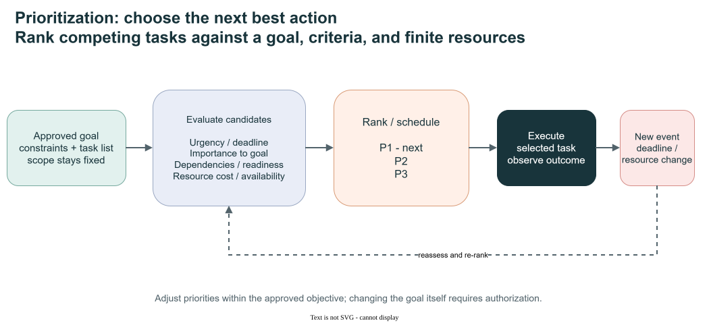
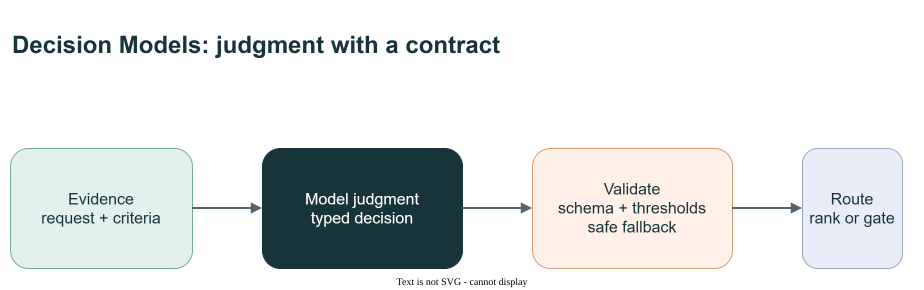

# Flow

[Overview](design-patterns.md) | **Flow** | [Reason & Improve](reason-and-improve.md) | [Knowledge & Action](knowledge-and-action.md) | [Collaboration](collaboration.md) | [Trust & Operations](trust-and-operations.md)

Flow patterns define the **shape of execution**: the step order, which branch runs, what runs concurrently, and what comes first.

- **Use when** a task has identifiable steps or categories, independent sub-tasks, or competing work items.
- **Watch for** serial latency in chains, misrouting, and aggregation conflicts after fan-out. Unbounded plans are another risk.
- **Repository note:** Decision Models belongs here. It supplies typed judgments that drive routing, ranking, and gating.

The opening illustration is a conceptual overview, not an exact execution trace or a promise of particular retry counts, capabilities or acceptance. The pattern diagrams and **Demo contract** notes below distinguish the concepts from runnable behavior.

## Patterns in this family

| Pattern | C# / MAF demo |
|---|---|
| [Prompt Chaining (Chapter 1)](#prompt-chaining-chapter-1) | [PromptChaining](../dotnet/src/PromptChaining/README.md) |
| [Routing (Chapter 2)](#routing-chapter-2) | [Routing](../dotnet/src/Routing/README.md) |
| [Parallelization (Chapter 3)](#parallelization-chapter-3) | [Parallelization](../dotnet/src/Parallelization/README.md) |
| [Planning (Chapter 6)](#planning-chapter-6) | [Planning](../dotnet/src/Planning/README.md) |
| [Prioritization (Chapter 20)](#prioritization-chapter-20) | [Prioritization](../dotnet/src/Prioritization/README.md) |
| [Decision Models (Repository addition)](#decision-models-repository-addition) | [DecisionModels](../dotnet/src/DecisionModels/README.md) |

Read in order using **Previous / Next** below, or jump directly to a pattern. Book chapter numbers are provenance; Decision Models and Agent Harness are repository additions.

## Prompt Chaining (Chapter 1)

**C# demo:** [PromptChaining](../dotnet/src/PromptChaining/README.md) | [Family contents](#patterns-in-this-family)

Also called the **Pipeline pattern**, prompt chaining decomposes a task into focused stages and passes each stage's result to the next. It is easier to inspect and debug than a monolithic prompt, and stages can include tools or external systems as well as model calls. Structured outputs, such as validated JSON, make stage boundaries and handoffs explicit.

Use it when the task has distinct, mostly known stages; prefer a fixed workflow over a planner when the path is repeatable. Context engineering—the selection of instructions, retrieved knowledge, tool results, state, and memory—is broader than prompt engineering, which focuses on phrasing the immediate instruction.

Editable diagram: [prompt-chaining-visual-summary.drawio](images/prompt-chaining-visual-summary.drawio).

Editable diagram: [context-engineering.drawio](images/context-engineering.drawio).

Original book illustration: [Figure 32.1](../book/Agentic_Design_Patterns_Complete.pdf).

**Demo contract:** Two model stages produce typed specifications; code validates JSON. **Boundary:** Validation is not a third agent.

**Previous:** [Guide overview](design-patterns.md) | [Family contents](#patterns-in-this-family) | **Next:** [Routing (Chapter 2)](#routing-chapter-2)

## Routing (Chapter 2)

**C# demo:** [Routing](../dotnet/src/Routing/README.md) | [Family contents](#patterns-in-this-family)

Routing chooses a tool, function, workflow, or specialist based on the request or current state. The decision can be **rule-based** (explicit fields or conditions), **embedding-based** (semantic similarity to route examples), **classifier-based** (a trained model), or **LLM-based** (a generative model chooses a route). It can run at intake, between workflow stages, or inside a subroutine.

Use routing when different inputs genuinely need different paths. Define route boundaries and a clarification or safe fallback for uncertain cases; semantic similarity and a plausible model-selected label are not proof that the route is correct.

Editable diagram: [routing-visual-summary.drawio](images/routing-visual-summary.drawio).

Original book illustration: [Figure 46.1](../book/Agentic_Design_Patterns_Complete.pdf).

**Demo contract:** Exactly one booking, information or unclear path. **Boundary:** Unclear terminates; no automatic conversational retry.

**Previous:** [Prompt Chaining (Chapter 1)](#prompt-chaining-chapter-1) | [Family contents](#patterns-in-this-family) | **Next:** [Parallelization (Chapter 3)](#parallelization-chapter-3)

## Parallelization (Chapter 3)

**C# demo:** [Parallelization](../dotnet/src/Parallelization/README.md) | [Family contents](#patterns-in-this-family)

Parallelization runs independent model calls, tools, or agents concurrently, then joins their results before dependent work proceeds. It is useful for independent analyses, separate data chunks, or slow external calls. It does not remove dependencies: a step that needs another step's output must wait.

Use it when the work can safely be split. Define how to handle partial failures and reconcile conflicting results, and measure end-to-end benefit against coordination overhead and resource use.

Editable diagram: [parallelization-visual-summary.drawio](images/parallelization-visual-summary.drawio).

Original book illustration: [Figure 49.1](../book/Agentic_Design_Patterns_Complete.pdf).

**Demo contract:** Three independent workers join before synthesis. **Boundary:** All-or-fail; dependent synthesis is serial.

**Previous:** [Routing (Chapter 2)](#routing-chapter-2) | [Family contents](#patterns-in-this-family) | **Next:** [Planning (Chapter 6)](#planning-chapter-6)

## Planning (Chapter 6)

**C# demo:** [Planning](../dotnet/src/Planning/README.md) | [Family contents](#patterns-in-this-family)

Planning turns an initial state and goal into an ordered set of actions, managing dependencies and adapting as results or constraints change. It is most useful when the **how** must be discovered—for example, an investigation whose next research step depends on evidence found so far. If the steps are already known and repeatable, use a fixed workflow instead.

Give plans explicit success criteria, bounded steps, and a stopping condition. Verify completion against observable evidence rather than accepting the planner's own claim that the goal is done.

Editable diagram: [planning-visual-summary.drawio](images/planning-visual-summary.drawio).

Original book illustration: [Figure 102.1](../book/Agentic_Design_Patterns_Complete.pdf).

**Demo contract:** A typed 3-6-step plan becomes a writer summary. **Boundary:** No tool execution or replanning in plan-write.

**Previous:** [Parallelization (Chapter 3)](#parallelization-chapter-3) | [Family contents](#patterns-in-this-family) | **Next:** [Prioritization (Chapter 20)](#prioritization-chapter-20)

## Prioritization (Chapter 20)

**C# demo:** [Prioritization](../dotnet/src/Prioritization/README.md) | [Family contents](#patterns-in-this-family)

Prioritization ranks or schedules competing goals, tasks, and next actions against urgency, importance, dependencies, resources, cost/benefit, and user preferences. Priorities may be reassessed as deadlines, events, or resource conditions change, at strategic, plan, or immediate-action level.

Use it when an agent must choose among competing work under constraints. The agent may adjust execution focus within delegated authority, but changing the approved objective or hard constraints requires authorization.

Editable diagram: [prioritization-visual-summary.drawio](images/prioritization-visual-summary.drawio).

Original book illustration: [Figure 329.1](../book/Agentic_Design_Patterns_Complete.pdf).

**Demo contract:** Validated priority/FIFO task ordering. **Boundary:** No task execution, durability or dynamic dependency scheduler.

**Previous:** [Planning (Chapter 6)](#planning-chapter-6) | [Family contents](#patterns-in-this-family) | **Next:** [Decision Models (Repository addition)](#decision-models-repository-addition)

## Decision Models (Repository addition)

**C# demo:** [DecisionModels](../dotnet/src/DecisionModels/README.md) | [Family contents](#patterns-in-this-family)

Decision Models provide typed choices, rankings and scores that can drive routing or gating. Their probability outputs require representative calibration measurements; being structured does not itself make a judgment calibrated. Keep criteria explicit and validate outputs before changing control flow.

Editable diagram: [decision-models-visual-summary.drawio](images/decision-models-visual-summary.drawio).

**Demo contract:** Typed judgments enter deterministic policy and routing. **Boundary:** Separate decision deployments; probabilities do not grant authority.

**Previous:** [Prioritization (Chapter 20)](#prioritization-chapter-20) | [Family contents](#patterns-in-this-family) | **Next:** [Reflection (Chapter 4)](reason-and-improve.md#reflection-chapter-4)

---

[Overview](design-patterns.md) | **Flow** | [Reason & Improve](reason-and-improve.md) | [Knowledge & Action](knowledge-and-action.md) | [Collaboration](collaboration.md) | [Trust & Operations](trust-and-operations.md)

**Previous:** [Guide overview](design-patterns.md) | **Next family:** [Reason & Improve](reason-and-improve.md)
