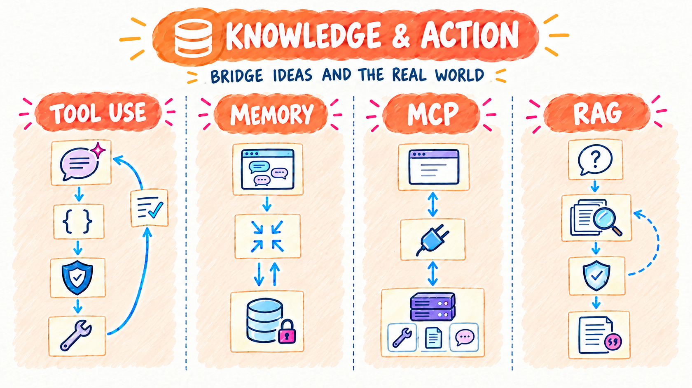
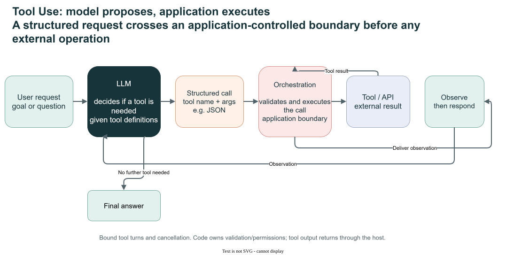
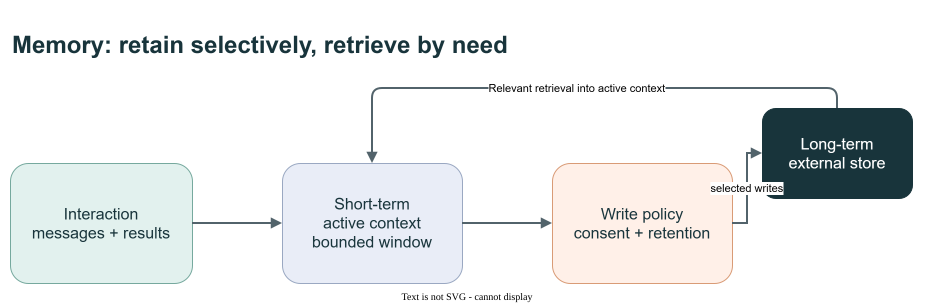
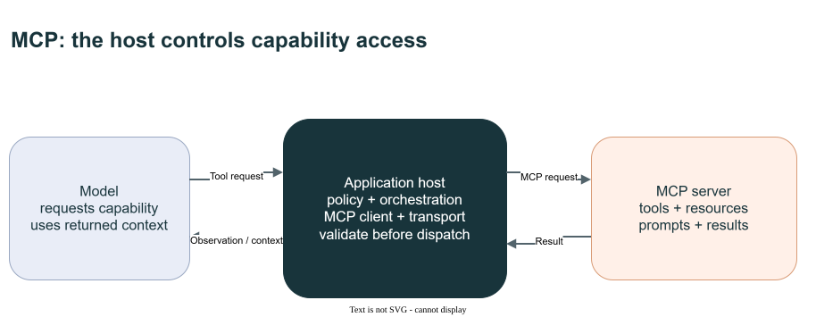
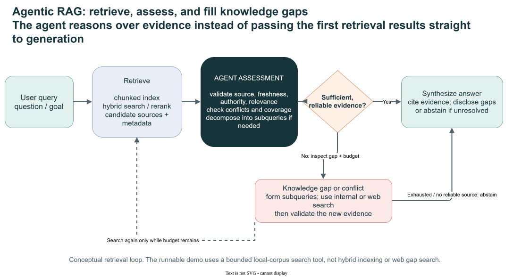

# Knowledge & Action

[Overview](design-patterns.md) | [Flow](flow.md) | [Reason & Improve](reason-and-improve.md) | **Knowledge & Action** | [Collaboration](collaboration.md) | [Trust & Operations](trust-and-operations.md)

These patterns connect the model to the world. They **ground** it in data through RAG and memory, and let it **act** through tools and MCP.

- **Use when** the answer depends on private, current, or remembered information, or when the agent must change state in another system.
- **Watch for** irrelevant retrieval, stale memory, and over-broad tools. Every tool expands the attack surface.

The opening illustration is a conceptual overview, not an exact execution trace or a promise of particular retry counts, capabilities or acceptance. The pattern diagrams and **Demo contract** notes below distinguish the concepts from runnable behavior.

## Patterns in this family

| Pattern | C# / MAF demo |
|---|---|
| [Tool Use (Chapter 5)](#tool-use-chapter-5) | [ToolUse](../dotnet/src/ToolUse/README.md) |
| [Memory Management (Chapter 8)](#memory-management-chapter-8) | [Memory](../dotnet/src/Memory/README.md) |
| [Model Context Protocol (MCP, Chapter 10)](#model-context-protocol-mcp-chapter-10) | [MCP](../dotnet/src/MCP/README.md) |
| [Knowledge Retrieval (RAG, Chapter 14)](#knowledge-retrieval-rag-chapter-14) | [RAG](../dotnet/src/RAG/README.md) |

Read in order using **Previous / Next** below, or jump directly to a pattern. Book chapter numbers are provenance; Decision Models and Agent Harness are repository additions.

## Tool Use (Chapter 5)

**C# demo:** [ToolUse](../dotnet/src/ToolUse/README.md) | [Family contents](#patterns-in-this-family)

The model considers available tools and may request a structured call. The orchestration layer validates and dispatches that request; the result returns as an observation that can inform the answer or another bounded action. Tool use supports current or private information, precise calculations, code execution, and changes in external systems.

Treat tool descriptions and arguments as an interface contract. Validate calls and results, apply least privilege and authorization in the application, and make consequential actions explicit and reviewable.

Editable diagram: [tool-use-visual-summary.drawio](images/tool-use-visual-summary.drawio).

Original book illustration: [Figure 80.1](../book/Agentic_Design_Patterns_Complete.pdf).

**Demo contract:** Application-hosted typed tools and results. **Boundary:** Native sandbox/search variants are optional.

**Previous:** [Exploration and Discovery (Chapter 21)](reason-and-improve.md#exploration-and-discovery-chapter-21) | [Family contents](#patterns-in-this-family) | **Next:** [Memory Management (Chapter 8)](#memory-management-chapter-8)

## Memory Management (Chapter 8)

**C# demo:** [Memory](../dotnet/src/Memory/README.md) | [Family contents](#patterns-in-this-family)

**Short-term memory** is the active conversation state—recent messages, tool results, and reflections—held in a limited context window. Compaction summarizes older context to retain useful information, but remains temporary and session-scoped. **Long-term memory** persists outside that context, for example in a database or knowledge store, and is retrieved when relevant.

Use memory when continuity, task progress, history, or personalization matters. Decide what should persist, how it is retrieved and updated, and how privacy, staleness, and deletion are handled.

Editable diagram: [memory-management-visual-summary.drawio](images/memory-management-visual-summary.drawio).

Original book illustration: [Figure 149.1](../book/Agentic_Design_Patterns_Complete.pdf).

**Demo contract:** Session state and serialization round-trip. **Boundary:** Managed memory adds embeddings, identity and asynchronous lifecycle.

**Previous:** [Tool Use (Chapter 5)](#tool-use-chapter-5) | [Family contents](#patterns-in-this-family) | **Next:** [Model Context Protocol (MCP, Chapter 10)](#model-context-protocol-mcp-chapter-10)

## Model Context Protocol (MCP, Chapter 10)

**C# demo:** [MCP](../dotnet/src/MCP/README.md) | [Family contents](#patterns-in-this-family)

MCP standardizes communication between an AI application (host), its MCP clients, and MCP servers. Servers can expose tools, resources, and prompts; the host controls how these capabilities are presented to a model and used. MCP and model function calling operate at different layers and can be composed: the model requests a call, the host validates it, and an MCP client can dispatch it to a server.

Use MCP when interoperability, discovery, or reuse across independently maintained servers justifies the protocol. A small application with a few fixed in-process functions may be simpler without it. MCP does not provide orchestration, authorization policy, or a guarantee that a server's capability is safe. Configure compatible clients, transports, authentication, and permissions, then validate each tool's inputs and effects.

Reference: [MCP Architecture Overview](https://modelcontextprotocol.io/docs/2026-07-28/learn/architecture).

Editable diagram: [mcp-visual-summary.drawio](images/mcp-visual-summary.drawio).

Original book illustration: [Figure 177.1](../book/Agentic_Design_Patterns_Complete.pdf).

**Demo contract:** Greeting over HTTP or confined filesystem over stdio. **Boundary:** A local endpoint is not reachable from Foundry by default.

**Previous:** [Memory Management (Chapter 8)](#memory-management-chapter-8) | [Family contents](#patterns-in-this-family) | **Next:** [Knowledge Retrieval (RAG, Chapter 14)](#knowledge-retrieval-rag-chapter-14)

## Knowledge Retrieval (RAG, Chapter 14)

**C# demo:** [RAG](../dotnet/src/RAG/README.md) | [Family contents](#patterns-in-this-family)

Retrieval-augmented generation searches external sources and adds selected evidence to the model's context. Embeddings support semantic search; hybrid search combines semantic and keyword retrieval; reranking can reorder candidates at extra compute and latency cost. Chunking, metadata, provenance, and index freshness determine whether relevant evidence can be found with its qualifications intact.

A more agentic retrieval flow can retrieve candidates, validate source relevance and authority, decompose complex questions, reconcile conflicts, identify gaps, and synthesize a cited answer. Preserve query-to-source links and disclose gaps or abstain when evidence is insufficient.

Common failure modes include missing or noisy retrieval, fragmented evidence, stale or conflicting sources, context lost at chunk boundaries, and unbounded tool loops. Retrieval and citations reduce some grounding problems but cannot guarantee factual accuracy, completeness, or currentness; evaluate retrieval and answer quality and account for the added latency and cost.

Editable diagram: [agentic-rag-visual-summary.drawio](images/agentic-rag-visual-summary.drawio).

Original book illustration: [Figure 213.1](../book/Agentic_Design_Patterns_Complete.pdf).

**Demo contract:** Cited answers from a local corpus using a search tool. **Boundary:** No hybrid index, web gap search or guaranteed truth.

**Previous:** [Model Context Protocol (MCP, Chapter 10)](#model-context-protocol-mcp-chapter-10) | [Family contents](#patterns-in-this-family) | **Next:** [Multi-Agent Collaboration (Chapter 7)](collaboration.md#multi-agent-collaboration-chapter-7)

---

[Overview](design-patterns.md) | [Flow](flow.md) | [Reason & Improve](reason-and-improve.md) | **Knowledge & Action** | [Collaboration](collaboration.md) | [Trust & Operations](trust-and-operations.md)

**Previous family:** [Reason & Improve](reason-and-improve.md) | **Next family:** [Collaboration](collaboration.md)
