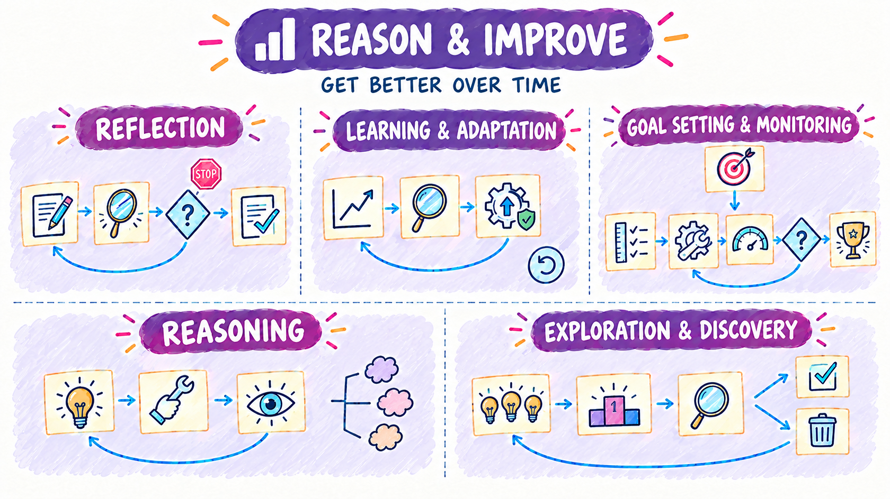
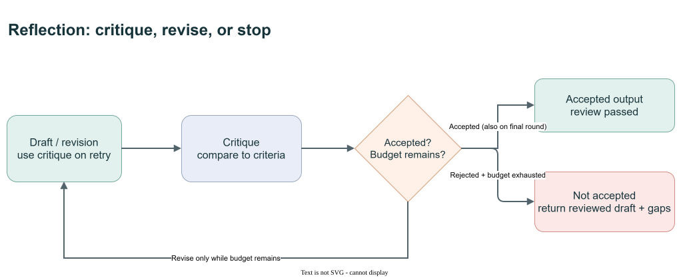
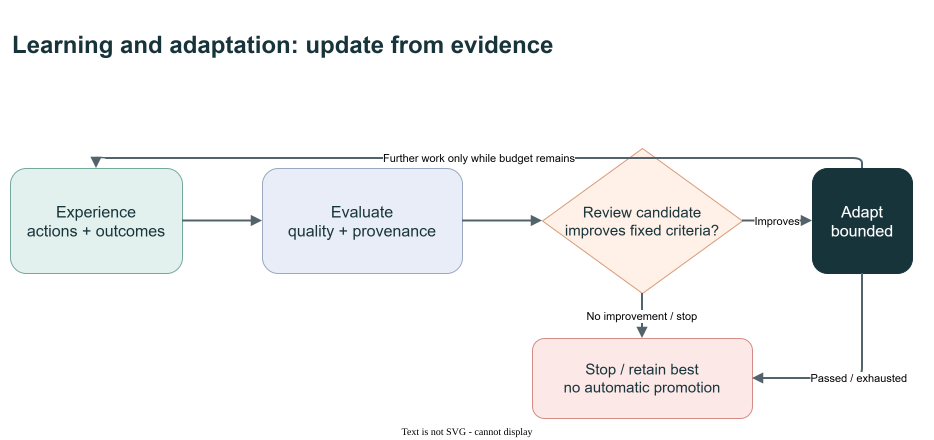
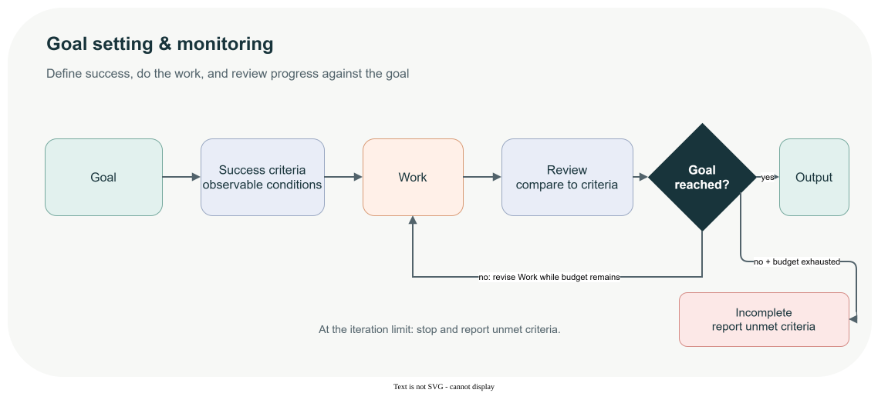
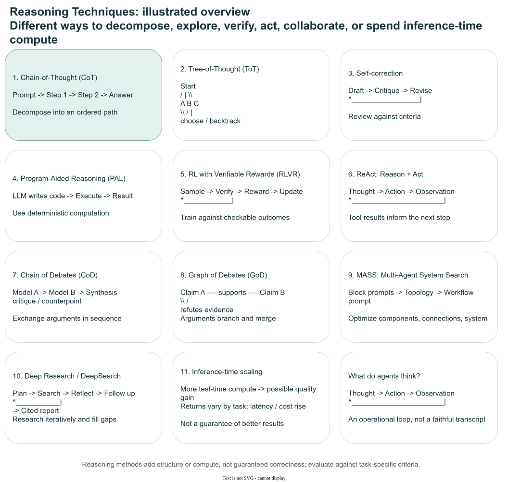
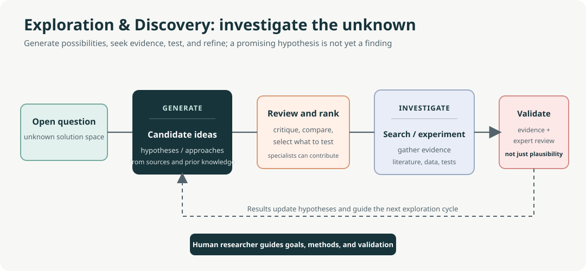

# Reason & Improve

[Overview](design-patterns.md) | [Flow](flow.md) | **Reason & Improve** | [Knowledge & Action](knowledge-and-action.md) | [Collaboration](collaboration.md) | [Trust & Operations](trust-and-operations.md)

These patterns spend extra inference to **raise the quality** of an answer. They use structured reasoning, critique-and-revise loops, explicit goals, feedback-driven adaptation, and hypothesis exploration.

- **Use when** correctness or quality matters more than latency, and success criteria can be stated.
- **Watch for** loops without stop conditions, a critic that shares the generator's blind spots, and rising cost.

The opening illustration is a conceptual overview, not an exact execution trace or a promise of particular retry counts, capabilities or acceptance. The pattern diagrams and **Demo contract** notes below distinguish the concepts from runnable behavior.

## Patterns in this family

| Pattern | C# / MAF demo |
|---|---|
| [Reflection (Chapter 4)](#reflection-chapter-4) | [Reflection](../dotnet/src/Reflection/README.md) |
| [Learning and Adaptation (Chapter 9)](#learning-and-adaptation-chapter-9) | [LearningAdaptation](../dotnet/src/LearningAdaptation/README.md) |
| [Goal Setting and Monitoring (Chapter 11)](#goal-setting-and-monitoring-chapter-11) | [GoalSettingMonitoring](../dotnet/src/GoalSettingMonitoring/README.md) |
| [Reasoning Techniques (Chapter 17)](#reasoning-techniques-chapter-17) | [Reasoning](../dotnet/src/Reasoning/README.md) |
| [Exploration and Discovery (Chapter 21)](#exploration-and-discovery-chapter-21) | [ExplorationDiscovery](../dotnet/src/ExplorationDiscovery/README.md) |

Read in order using **Previous / Next** below, or jump directly to a pattern. Book chapter numbers are provenance; Decision Models and Agent Harness are repository additions.

## Reflection (Chapter 4)

**C# demo:** [Reflection](../dotnet/src/Reflection/README.md) | [Family contents](#patterns-in-this-family)

Reflection is a feedback loop: create a draft, critique it against criteria, decide how to address the gaps, then refine or stop. A single agent can review its own work, or a separate critic can divide the roles. A separate critic may bring a different perspective, but does not guarantee objectivity; both approaches add inference cost.

Use it when correctness or quality matters more than a single-pass response's speed. Set a bounded number of iterations and criteria the application can evaluate.

Editable diagram: [reflection-visual-summary.drawio](images/reflection-visual-summary.drawio).

Original book illustration: [Figure 73.1](../book/Agentic_Design_Patterns_Complete.pdf).

**Demo contract:** Every draft is reviewed; final-round acceptance wins. **Boundary:** Exhaustion returns not-accepted and gaps.

**Previous:** [Decision Models (Repository addition)](flow.md#decision-models-repository-addition) | [Family contents](#patterns-in-this-family) | **Next:** [Learning and Adaptation (Chapter 9)](#learning-and-adaptation-chapter-9)

## Learning and Adaptation (Chapter 9)

**C# demo:** [LearningAdaptation](../dotnet/src/LearningAdaptation/README.md) | [Family contents](#patterns-in-this-family)

Learning and adaptation cover mechanisms that change knowledge, behaviour, or strategy from data and experience, from supervised or reinforcement learning to memory-based adaptation and evolutionary self-improvement. These mechanisms are not interchangeable: model parameter updates, in-context adaptation, retrieval from memory, and an agent modifying its own code have different risks and evaluation needs.

Consider this pattern in dynamic environments that require continual improvement or personalization. Verify the evidence and evaluation setup behind performance claims—including examples such as SICA, AlphaEvolve, and OpenEvolve—and distinguish measured outcomes from broader claims. Sandbox self-modification and provide human oversight, rollback, and independent tests before granting it greater autonomy.

Editable diagram: [learning-adaptation-visual-summary.drawio](images/learning-adaptation-visual-summary.drawio).

Original book illustration: [Figure 156.1](../book/Agentic_Design_Patterns_Complete.pdf).

**Demo contract:** Candidate prompts are scored against fixed phrase criteria. **Boundary:** Best prompt is local; no weight update or deployment.

**Previous:** [Reflection (Chapter 4)](#reflection-chapter-4) | [Family contents](#patterns-in-this-family) | **Next:** [Goal Setting and Monitoring (Chapter 11)](#goal-setting-and-monitoring-chapter-11)

## Goal Setting and Monitoring (Chapter 11)

**C# demo:** [GoalSettingMonitoring](../dotnet/src/GoalSettingMonitoring/README.md) | [Family contents](#patterns-in-this-family)

The cycle starts with a goal, which is made actionable through explicit, observable success criteria. The agent does work, reviews it against those criteria, and revises the work when needed; adaptation is the response to a failed review, not a separate stage. It ends when the review determines that the goal is reached and output is returned, or when the iteration limit is reached and unmet criteria are reported.

Use it for multi-step work with a defined outcome. Compare the work to stated criteria rather than trusting its completion claim, bound the revise loop, and report incomplete when the limit is reached.

Editable diagram: [goal-setting-monitoring-visual-summary.drawio](images/goal-setting-monitoring-visual-summary.drawio).

Original book illustration: [Figure 188.1](../book/Agentic_Design_Patterns_Complete.pdf).

**Demo contract:** Immutable .NET deliverable criteria, checked in code. **Boundary:** Legacy generated Python is saved, never executed.

**Previous:** [Learning and Adaptation (Chapter 9)](#learning-and-adaptation-chapter-9) | [Family contents](#patterns-in-this-family) | **Next:** [Reasoning Techniques (Chapter 17)](#reasoning-techniques-chapter-17)

## Reasoning Techniques (Chapter 17)

**C# demo:** [Reasoning](../dotnet/src/Reasoning/README.md) | [Family contents](#patterns-in-this-family)

Reasoning techniques structure multi-step problem solving. **Chain-of-Thought** organizes intermediate steps; **Tree-of-Thought** explores and prunes alternatives; **self-refinement** critiques and revises; **program-aided reasoning** delegates deterministic calculation to code; **ReAct** interleaves reasoning, tool actions, and observations; and **self-consistency** compares multiple candidate answers. Debate, graph-of-debate, and deep-research approaches structure multi-perspective review or iterative search. **MASS** searches over agent roles, workflow topology, and prompts.

Choose the simplest technique that fits the task and evaluate the result. More inference-time computation can help on some tasks, but increases latency and cost and does not guarantee correctness. A generated rationale is not necessarily a faithful record of hidden reasoning or proof that an answer is right.

Editable diagram: [reasoning-techniques-overview.drawio](images/reasoning-techniques-overview.drawio).

Original book illustration: [Figure 262.1](../book/Agentic_Design_Patterns_Complete.pdf).

**Demo contract:** Structured/model-assisted problem-solving variants. **Boundary:** A rationale is neither hidden reasoning nor a correctness proof.

**Previous:** [Goal Setting and Monitoring (Chapter 11)](#goal-setting-and-monitoring-chapter-11) | [Family contents](#patterns-in-this-family) | **Next:** [Exploration and Discovery (Chapter 21)](#exploration-and-discovery-chapter-21)

## Exploration and Discovery (Chapter 21)

**C# demo:** [ExplorationDiscovery](../dotnet/src/ExplorationDiscovery/README.md) | [Family contents](#patterns-in-this-family)

Exploration seeks new information, possibilities, or hypotheses when the solution space is not fully known. A useful cycle is to generate candidates, critique and rank them, investigate the strongest candidates, then refine or discard them using evidence. Specialized roles can divide generation, ranking, investigation, and synthesis.

Use it for open-ended discovery, not merely execution of a known plan. Treat generated hypotheses as candidates—not findings—and validate them against reliable sources, benchmarks, or experiments. Incomplete sources, hallucinations, sparse negative results, and the compute required to test possibilities limit what exploration can establish.

Editable diagram: [exploration-discovery-visual-summary.drawio](images/exploration-discovery-visual-summary.drawio).

Original book illustration: [Figure 335.1](../book/Agentic_Design_Patterns_Complete.pdf).

**Demo contract:** At most two proposals with three concurrent reviewers. **Boundary:** Proposals are not experimentally validated discoveries.

**Previous:** [Reasoning Techniques (Chapter 17)](#reasoning-techniques-chapter-17) | [Family contents](#patterns-in-this-family) | **Next:** [Tool Use (Chapter 5)](knowledge-and-action.md#tool-use-chapter-5)

---

[Overview](design-patterns.md) | [Flow](flow.md) | **Reason & Improve** | [Knowledge & Action](knowledge-and-action.md) | [Collaboration](collaboration.md) | [Trust & Operations](trust-and-operations.md)

**Previous family:** [Flow](flow.md) | **Next family:** [Knowledge & Action](knowledge-and-action.md)
