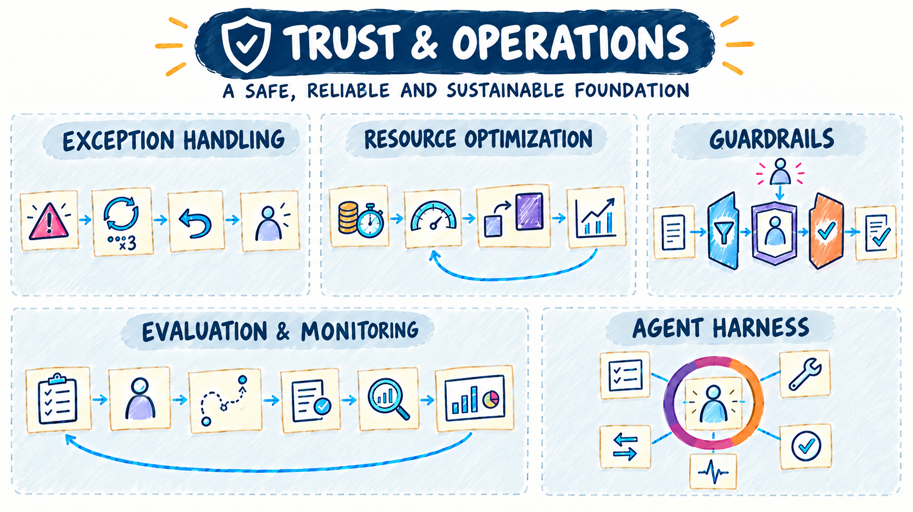
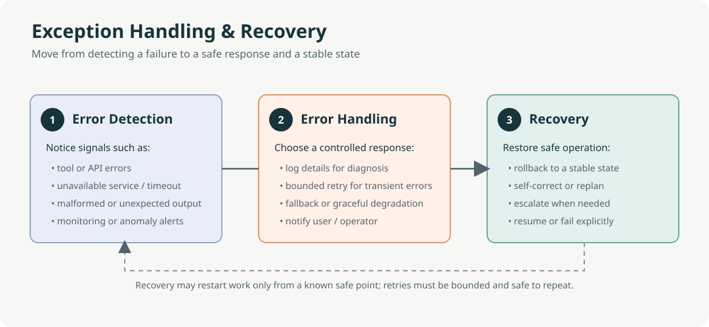
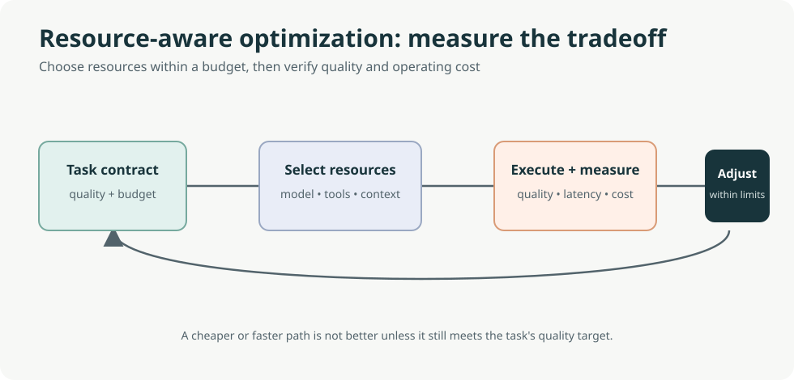
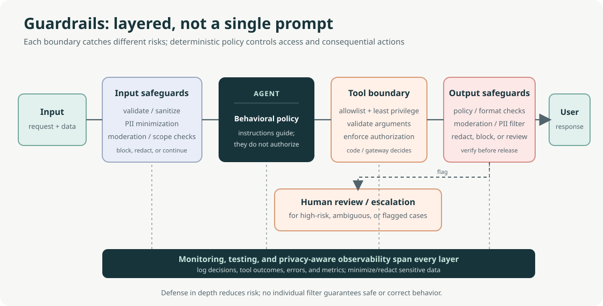
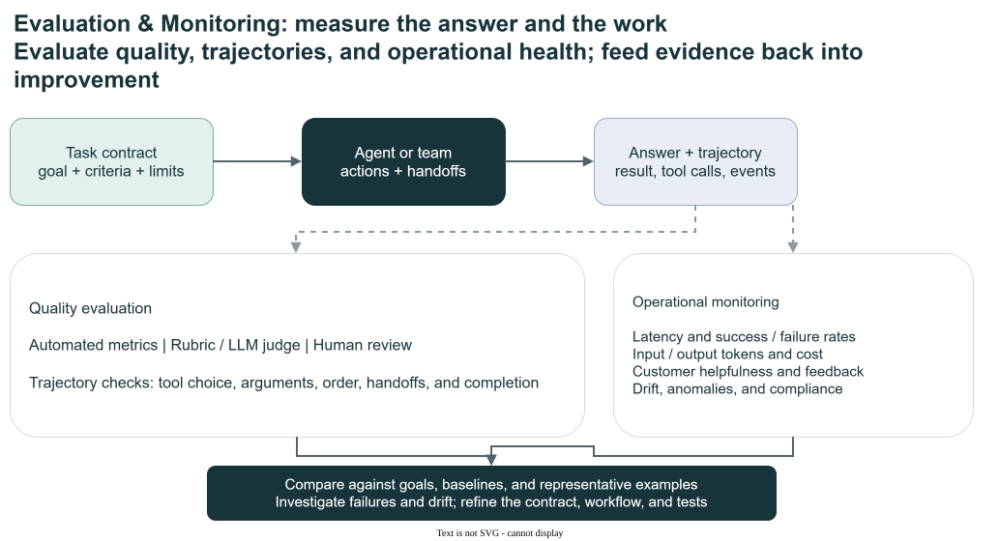
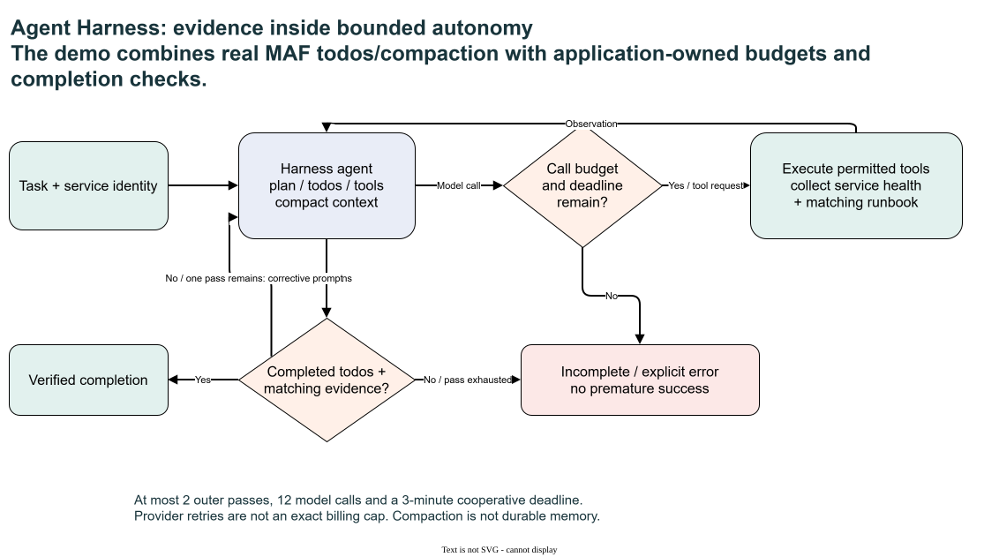

# Trust & Operations

[Overview](design-patterns.md) | [Flow](flow.md) | [Reason & Improve](reason-and-improve.md) | [Knowledge & Action](knowledge-and-action.md) | [Collaboration](collaboration.md) | **Trust & Operations**

These patterns add controls needed for reliable operation; examples alone do not make a production system. They bound behaviour, recover from failures, control cost, measure quality, and package the runtime.

- **Use when** always, in proportion to risk. This family applies to every other family.
- **Repository note:** Agent Harness, an enterprise extension, belongs here because it packages operational controls (todos, bounded tools, compaction, tracing, and completion checks) around an agent.

The opening illustration is a conceptual overview, not an exact execution trace or a promise of particular retry counts, capabilities or acceptance. The pattern diagrams and **Demo contract** notes below distinguish the concepts from runnable behavior.

The retry symbol marked **x3** is illustrative: the local ExceptionHandling demo allows **two primary lookup attempts** before its labeled degraded fallback. Recovery stages are alternatives selected by policy, not mandatory steps after every error.

## Patterns in this family

| Pattern | C# / MAF demo |
|---|---|
| [Exception Handling and Recovery (Chapter 12)](#exception-handling-and-recovery-chapter-12) | [ExceptionHandling](../dotnet/src/ExceptionHandling/README.md) |
| [Resource-Aware Optimization (Chapter 16)](#resource-aware-optimization-chapter-16) | [ResourceOptimization](../dotnet/src/ResourceOptimization/README.md) |
| [Guardrails and Safety (Chapter 18)](#guardrails-and-safety-chapter-18) | [Guardrails](../dotnet/src/Guardrails/README.md) |
| [Evaluation and Monitoring (Chapter 19)](#evaluation-and-monitoring-chapter-19) | [Evaluation](../dotnet/src/Evaluation/README.md) |
| [Agent Harness (Repository addition)](#agent-harness-repository-addition) | [AgentHarness](../dotnet/src/AgentHarness/README.md) |

Read in order using **Previous / Next** below, or jump directly to a pattern. Book chapter numbers are provenance; Decision Models and Agent Harness are repository additions.

## Exception Handling and Recovery (Chapter 12)

**C# demo:** [ExceptionHandling](../dotnet/src/ExceptionHandling/README.md) | [Family contents](#patterns-in-this-family)

Resilience has three parts: **detect** failures and anomalies such as exceptions, timeouts, status errors, or malformed results; **handle** them through classification, logging, bounded retries for safe repeatable operations, fallback, or clear notification; and **recover** through rollback, diagnosis, correction, or replanning. Escalate or fail explicitly when recovery would be unsafe or unsuccessful.

Plan failure paths whenever tools or external systems are involved. Avoid unbounded retries and silent degradation; define when partial service is acceptable and what the user or operator must be told.

Editable diagram: [exception-recovery-visual-summary.drawio](images/exception-recovery-visual-summary.drawio).

Original book illustration: [Figure 195.1](../book/Agentic_Design_Patterns_Complete.pdf).

**Demo contract:** Bounded recoverable lookup retry and labeled degraded fallback. **Boundary:** Model/nonrecoverable failures propagate.

**Previous:** [Inter-Agent Communication (A2A, Chapter 15)](collaboration.md#inter-agent-communication-a2a-chapter-15) | [Family contents](#patterns-in-this-family) | **Next:** [Resource-Aware Optimization (Chapter 16)](#resource-aware-optimization-chapter-16)

## Resource-Aware Optimization (Chapter 16)

**C# demo:** [ResourceOptimization](../dotnet/src/ResourceOptimization/README.md) | [Family contents](#patterns-in-this-family)

Resource optimization balances quality against explicit compute, time, energy, and financial budgets. Options include selecting models or tools by task needs, pruning or summarizing context, predicting capacity, scheduling parallel work, and degrading gracefully when preferred resources are unavailable.

Use it when resource limits matter, particularly when tasks have different needs. Measure quality, latency, and cost on representative work before claiming that a model-switching or allocation policy improves efficiency; a cheaper or faster path may also reduce quality.

Editable diagram: [resource-optimization-visual-summary.drawio](images/resource-optimization-visual-summary.drawio).

Original book illustration: [Figure 255.1](../book/Agentic_Design_Patterns_Complete.pdf).

**Demo contract:** Deterministic request classification and model selection. **Boundary:** Measures usage; does not prove savings or tune infrastructure.

**Previous:** [Exception Handling and Recovery (Chapter 12)](#exception-handling-and-recovery-chapter-12) | [Family contents](#patterns-in-this-family) | **Next:** [Guardrails and Safety (Chapter 18)](#guardrails-and-safety-chapter-18)

## Guardrails and Safety (Chapter 18)

**C# demo:** [Guardrails](../dotnet/src/Guardrails/README.md) | [Family contents](#patterns-in-this-family)

Use defense in depth: validate inputs, minimize or anonymize personal information, constrain behavior, restrict tools and permissions, check outputs, and escalate critical or ambiguous cases to people. Apply least privilege so each agent has only the data and capabilities its task requires. Structured logs of tool calls, outcomes, policy decisions, errors, and metrics support investigation; they are not a substitute for controls, and logs need access, retention, and data-minimization policies of their own.

Test normal, edge, and adversarial inputs, and combine independent safeguards rather than relying on prompts alone. Use checkpoints and rollback where recovery from an off-course action is needed.

Editable diagram: [guardrails-defense-in-depth.drawio](images/guardrails-defense-in-depth.drawio).

Original book illustration: [Figure 302.1](../book/Agentic_Design_Patterns_Complete.pdf).

**Demo contract:** Policy screening and tool identity checks. **Boundary:** Uncertainty requires clarification/review; native moderation optional.

**Previous:** [Resource-Aware Optimization (Chapter 16)](#resource-aware-optimization-chapter-16) | [Family contents](#patterns-in-this-family) | **Next:** [Evaluation and Monitoring (Chapter 19)](#evaluation-and-monitoring-chapter-19)

## Evaluation and Monitoring (Chapter 19)

**C# demo:** [Evaluation](../dotnet/src/Evaluation/README.md) | [Family contents](#patterns-in-this-family)

**Evaluation** measures whether outputs, actions, and workflows meet defined goals; **monitoring** tracks quality and operational health after deployment so drift, anomalies, and regressions can be detected. Combine deterministic checks, task-specific metrics, calibrated model judges, and human evaluation as appropriate. For tool-using systems, assess trajectories too: tool choice, arguments, action ordering, dependencies, and handoffs.

Monitor response quality, end-to-end and per-step latency, token usage and cost, task completion, user feedback, errors, retries, resource use, and drift. In multi-agent systems, measure both specialist and end-to-end performance, including handoff quality and attribution. Exact trajectory matching can reject valid alternative paths; overly permissive matching can miss harmful detours.

Use representative, maintained evaluation sets and A/B tests to assess changes. A task contract—deliverables, scope, sources, constraints, budget, and acceptance criteria—can make expectations more explicit, but is a design approach rather than a standardized protocol. No single score, including an LLM judge or rubric, should be treated as a complete safety gate.

Editable diagram: [evaluation-monitoring-visual-summary.drawio](images/evaluation-monitoring-visual-summary.drawio).

Original book illustration: [Figure 304.1](../book/Agentic_Design_Patterns_Complete.pdf).

**Demo contract:** Exact-match checks, timings/usage, rubric judging. **Boundary:** Native cloud jobs create resources; timeout does not cancel them.

**Previous:** [Guardrails and Safety (Chapter 18)](#guardrails-and-safety-chapter-18) | [Family contents](#patterns-in-this-family) | **Next:** [Agent Harness (Repository addition)](#agent-harness-repository-addition)

## Agent Harness (Repository addition)

**C# demo:** [AgentHarness](../dotnet/src/AgentHarness/README.md) | [Family contents](#patterns-in-this-family)

A harness combines agent capabilities with an application-owned runtime contract: task tracking, context compaction, permitted tools, call/deadline limits and completion verification. In this demo, success requires completed todos plus health and runbook evidence matching the requested service. A confident answer without that evidence is incomplete. Compaction keeps the current session usable; it does not replace durable memory or authorization.

Editable diagram: [agent-harness-visual-summary.drawio](images/agent-harness-visual-summary.drawio).

**Demo contract:** Todos, compaction, bounded calls and service-matched evidence. **Boundary:** Two passes / 12 calls / cooperative deadline, not a billing guarantee.

**Previous:** [Evaluation and Monitoring (Chapter 19)](#evaluation-and-monitoring-chapter-19) | [Family contents](#patterns-in-this-family) | **Next:** [Compose the patterns](design-patterns.md#composing-patterns)

---

[Overview](design-patterns.md) | [Flow](flow.md) | [Reason & Improve](reason-and-improve.md) | [Knowledge & Action](knowledge-and-action.md) | [Collaboration](collaboration.md) | **Trust & Operations**

**Previous family:** [Collaboration](collaboration.md) | **Next:** [Compose the patterns](design-patterns.md#composing-patterns)
