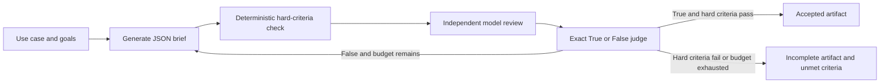

# Goal Setting and Monitoring

> Book: *Agentic Design Patterns* (Antonio Gulli), Chapter 11. Implemented with Microsoft Agent Framework (C#) and Microsoft Foundry.

This pattern makes completion criteria visible, reviews each draft, and bounds revision. The primary demo creates a structured .NET implementation brief. Application code—not the model—enforces immutable hard requirements for C#, .NET 10, and a minimum complete brief. A model review and exact `True` judge decision are still required; neither can override a failed hard check. Generated artifacts are proposals and are never executed.



## Where to Look in Code

| What | Where |
|---|---|
| Bounded workflow, roles, terminal branches | [GoalSettingWorkflow.cs](GoalSettingWorkflow.cs), `RunAsync` |
| Immutable, deterministic brief checks | [DotNetImplementationBrief.cs](Models/DotNetImplementationBrief.cs), `GoalSettingHardCriteria.Check` |
| Scenario and request limits | [GoalSettingRequest.cs](Models/GoalSettingRequest.cs), `Validate` |
| Artifact saving; no execution | [GoalSettingDemo.cs](GoalSettingDemo.cs), `RunAsync` |
| Hosted request parsing and scenario selection | [GoalSettingAgent.cs](../GoalSettingMonitoring.Hosted/GoalSettingAgent.cs) |

## What Runs

| Scenario | Output | Acceptance |
|---|---|---|
| `dotnet` (default) | Structured JSON implementation brief | Model judge says `True` **and** deterministic hard criteria pass |
| `python` (secondary) | Python code artifact with caller-safe header | Exact model judge verdict, as in the original notebook |
| Foundry-native | Not applicable: Foundry has no separate goal-loop primitive | Application code owns validation and stopping |
| Hosted companion | Same workflows over Responses; request-scoped isolation | [Hosted guide](../GoalSettingMonitoring.Hosted/README.md) |

The .NET brief schema has `title`, `language`, `targetFramework`, `summary`, and `implementationSteps`. Fixed checks require exact `C#` and `net10.0`, at least three non-empty steps, and non-empty title/summary. These rules are not request fields and cannot be changed by generated content or reviewer feedback. Invalid structure is reported as failed hard criteria and can be revised within the configured 1–5 round budget.

The Python scenario remains available with its original unique `.py` filename and safe caller-comment header. Its generated code is also never run.

## Notebook → C# Mapping

| Notebook concept | C# implementation |
|---|---|
| Goal-directed generation | `CodeGenerator`; JSON .NET brief by default, Python for `--scenario python` |
| Independent critique | `GoalReviewer`, informed by hard-check output in the .NET scenario |
| Goal verdict | `GoalJudge`; only exact `True` or `False` is accepted |
| Iteration and stopping | Typed workflow state and bounded conditional edges; exhaustion returns an incomplete result |
| Save artifact | `.json` under `generated-deliverables/` or `.py` under `generated-code/`; neither is executed |

## Setup and Run

Configure shared Foundry user-secrets as described in [dotnet/README.md](../../README.md). From the repository root:

```powershell
dotnet run --project dotnet/src/GoalSettingMonitoring
dotnet run --project dotnet/src/GoalSettingMonitoring -- --scenario python
dotnet run --project dotnet/src/GoalSettingMonitoring -- --scenario dotnet --use-case "Plan a small file utility" --goals "Use .NET 10;Include verification" --iterations 3 --output-dir .\out --deployment <alias>
dotnet test dotnet/tests/GoalSettingMonitoring.Tests
```

The default writes a JSON brief under `generated-deliverables/`; the explicit Python variant retains `generated-code/` and its safe `.py` header. The three roles make three model calls per round. Sensitive prompt/response tracing is **off by default**; console runs require the explicit `--include-sensitive-telemetry` flag to opt in.

## When to Use

- The deliverable can be reviewed against explicit criteria and can benefit from bounded revisions.
- You need to inspect drafts, critiques, and deterministic acceptance separately.
- Generated material remains a proposal until a separate test, human review, or deployment process adopts it.

## When Not to Use

- A model verdict must guarantee semantic correctness; use executable tests or domain-specific validators for that guarantee.
- Criteria cannot be stated in a form a reviewer or deterministic checker can evaluate.
- Iterations would trigger irreversible or expensive actions without separate approval and idempotency controls.

## Real-World Scenarios

1. Drafting a .NET implementation brief before development begins.
2. Preparing a content outline that must contain required sections.
3. Producing a data-transformation proposal for later sandboxed testing.
4. Revising an operational checklist before a human adopts it.

## Foundry Extensions

Use Foundry tracing with sensitive data enabled only in an access-controlled environment. Add independent tests, linters, or domain validators when requirements need stronger checks; evaluate prompts on representative tasks before changing the workflow.

## Risks and Tradeoffs

- Model review and judgment are probabilistic; in the .NET scenario they cannot bypass deterministic format and platform requirements.
- The fixed hard criteria check the brief's structure and target, not whether its proposed implementation is factually or semantically correct.
- Each round costs three model calls, and generation can still produce an incomplete result after the budget.
- Artifacts are not sandboxed or executed. The Python variant is retained for notebook compatibility, not as the primary .NET example.
