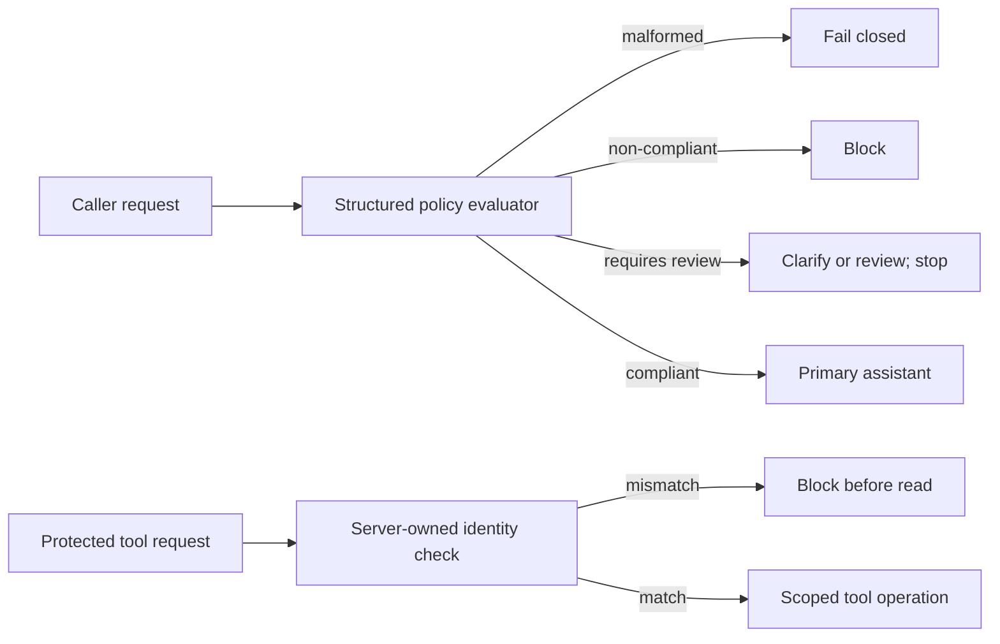

# Guardrails

> *Agentic Design Patterns*, Antonio Gulli, Chapter 18. C# / Microsoft Agent Framework.

The default policy flow screens a request before the assistant sees it. A structured policy judgment may admit, block, or request clarification/review. Uncertain requests do not reach the primary assistant. Malformed policy output fails closed. Deterministic identity checks remain separate and authoritative for protected tools.



## Where to Look in Code

- [GuardrailsAgent.cs](GuardrailsAgent.cs), `Create` / `ApplyPolicyAsync`: structured policy gate, conservative by default.
- [PolicyEvaluation.cs](Models/PolicyEvaluation.cs): `compliant`, `non-compliant`, and `requires-review` typed results.
- [GuardrailFunctions.cs](GuardrailFunctions.cs): exact authenticated-user comparison before a protected read.
- [Demos/ContentSafetyDemo.cs](Demos/ContentSafetyDemo.cs), `ShouldBlock`: optional Content Safety service and severity-4 threshold.

## Scenarios and notebook mapping

| Scenario | Behavior |
|---|---|
| `policy` (default) | One model-based evaluator; uncertainty returns clarification/review and stops before the assistant |
| `policy-legacy` | Explicit opt-in to the notebook's legacy rule: uncertainty is treated as compliant |
| `tool-validation` | Independent deterministic identity check for the protected profile tool |
| `content-safety` | Optional Azure Content Safety service; blocks severity 4 or higher |
| `all` | Runs the model scenarios and Content Safety; requires extra Content Safety settings |
| Hosted companion | Conservative policy by default; optional per-request `policyVariant`; [hosted guide](../Guardrails.Hosted/README.md) |

The notebook maps its policy evaluator to `policy`, practical structured validation to `PolicyEvaluation`, tool validation to `tool-validation`, and the original uncertain-means-compliant behavior to the explicitly named `policy-legacy` variant. Content Safety is an optional additional service, not a prerequisite for the default.

## Run

Configure .NET 10 and shared model settings in [dotnet/README.md](../../README.md). From the repository root:

```powershell
dotnet run --project dotnet/src/Guardrails
dotnet run --project dotnet/src/Guardrails -- policy-legacy
dotnet run --project dotnet/src/Guardrails -- tool-validation
dotnet run --project dotnet/src/Guardrails -- content-safety --text "Text to analyze"
dotnet test dotnet/tests/Guardrails.Tests
```

No arguments run only `policy` and require the shared model settings. Content Safety needs `Foundry:ContentSafetyEndpoint` and `Foundry:ContentSafetyApiKey` in user-secrets (or matching `Foundry__...` environment variables). Explicit `all` also runs Content Safety. Tool identity/profile values are synthetic fixtures. Sensitive prompt/response telemetry is off by default; do not enable it outside an access-controlled debugging environment.

## When to Use / Not to Use

Use a policy gate before assistant responses and deterministic authorization at tool boundaries. Do not treat an LLM classifier as a guarantee of harmlessness or as a substitute for authentication, access control, or human approval.

## Real-World Scenarios

1. Require clarification when a support request lacks enough context for domain-policy screening.
2. Reject account-tool requests whose caller-controlled identifier differs from authenticated identity.
3. Stop instruction-disclosure requests before a separate assistant sees them.
4. Add optional harm-category moderation where service coverage and availability fit the application.

## Tradeoffs and Foundry Extensions

Classification adds latency and cost and can produce false positives or negatives. The conservative default routes uncertainty to review, but still depends on the model correctly recognizing uncertainty. The legacy policy is preserved only as an explicit compatibility example. Azure Content Safety, Prompt Shields, and Foundry moderation features are distinct from the policy and identity checks shown here; output safeguards not implemented by this sample are not implied.

See [HOSTING.md](../../HOSTING.md) for deployment, inference RBAC, packaging, cost, and scoped cleanup.
