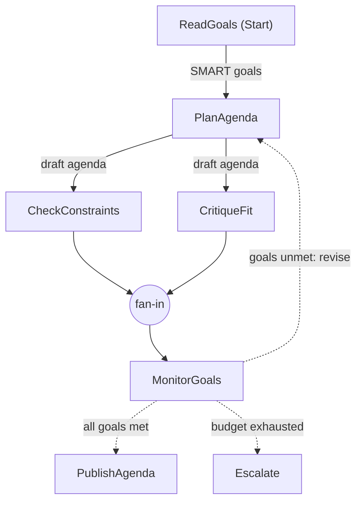

# Update Conference: local C# demos

Start with three small Microsoft Agent Framework (MAF) demos: **agent + tool -> workflow basics -> schedule RAG workflow**. Then explore the separate planning/goal-monitoring workflow, decision-model, and Harness agent demos. These are focused examples, not one integrated agenda product. All conference-specific code lives here; existing chapter implementations stay unchanged.

## Setup

Use the .NET 10 SDK selected by [global.json](global.json). Package versions come from [the central .NET manifest](../dotnet/Directory.Packages.props), imported rather than copied: MAF/Workflows/Harness 1.22.0 and Decisions.Foundry 0.7.0. The host also uses the repository's pinned preview Foundry hosting package.

From the repository root, configure the [shared local credentials](../dotnet/README.md) once:

```powershell
dotnet user-secrets set "Foundry:ProjectEndpoint" "https://<account>.services.ai.azure.com/api/projects/<project>" --project dotnet/src/Shared
dotnet user-secrets set "Foundry:ApiKey" "<your-key>" --project dotnet/src/Shared
dotnet user-secrets set "Foundry:ModelDeployment" "<chat-deployment>" --project dotnet/src/Shared
```

Use a chat model supporting function/tool calling for getting-started step 1, structured JSON output for the planning demo, and tool calling for the Harness page demo; `speaker-page --web` also needs a deployment that supports hosted web search through the Responses API. The schedule demo needs only text generation with enough context for the complete schedule (about 75 KB). Step 2 needs no model or credentials. Equivalent environment variables are `Foundry__ProjectEndpoint`, `Foundry__ApiKey`, and `Foundry__ModelDeployment`. Keep keys out of code, shell recordings, captures, and Git. Local means code, tools, and fixtures run on your machine; model inference still calls Foundry.

Then work **from this folder**:

```powershell
Set-Location update-conference-26
dotnet build ConferenceDemos.slnx
dotnet run --project ConferenceDemos -- check-data
dotnet test ConferenceDemos.Tests\ConferenceDemos.Tests.csproj
```

`check-data` and the tests need no credentials or network model calls. The canonical [schedule](Update_Conference_Prague_2026_Schedule.md) is an embedded resource, not a second edited copy. Source IDs such as `Update_Conference_Prague_2026_Schedule.md#s13` resolve to its anchors.

### Launch profiles

[ConferenceDemos/Properties/launchSettings.json](ConferenceDemos/Properties/launchSettings.json) starts with **Getting started 1 - Agent and tool**, **Getting started 2 - Workflow basics**, and **Getting started 3 - RAG workflow**, in presentation order. Existing profiles remain available for the other demos, the plain schedule baseline, day 2/no-match retrieval, the planning graph and escalation path, the Harness page with and without web search, OpenAI recording, and the offline data check. Select a profile in your IDE, or run one by name from this folder:

```powershell
dotnet run --project ConferenceDemos --launch-profile "Schedule - RAG day 1"
dotnet run --project ConferenceDemos --launch-profile "Check data"
```

The **Decisions - compare** profile uses the bundled illustrative JSON sample, so no recording is needed. **Decisions - record OpenAI** and **Decisions - compare recorded OpenAI** use `captures\openai-decisions.json`, relative to the process working directory; use the same working directory for recording and comparison. Recording requires the configured OpenAI decision deployment and refuses to overwrite an existing capture. Profiles contain no credentials.

Model-backed demos print their user question or request before inference. The planning demo prints its SMART goals first, and both decision commands show the shared session and attendee interest. Decision questions, choices, and the score scale are supplied directly at their respective method calls.

## Getting started: arrive in Prague, then choose a session

Run these three commands **from this folder**, in order:

```powershell
dotnet run --project ConferenceDemos -- agent
dotnet run --project ConferenceDemos -- workflow Alex
dotnet run --project ConferenceDemos -- rag
```

### 1. Agent + tool: a question, then Prague weather

[AgentDemo.cs](ConferenceDemos/AgentDemo.cs) creates one `ChatClientAgent` from the shared `IChatClient`, gives it short instructions, and calls `RunAsync` twice:

1. "In one sentence, welcome a .NET developer to Update Conference in Prague."
2. "What is the weather like in Prague today?"

The first answer is ordinary model-generated text. For the second, MAF lets the model invoke `GetPragueWeather`, a normal C# method exposed with `[Description]` and `AIFunctionFactory.Create`. The tool prints its invocation and returns **fixed demo data, not a live forecast**. No weather service, location parser, or additional configuration is needed.

Expect two question/answer pairs, with `Tool call: GetPragueWeather -> Fixed demo data, not a live forecast: Prague is cloudy, 12 C.` during the weather interaction. The exact model wording can vary. The tool result is data the model uses to compose its answer; it is not another agent.

**Concepts:** `IChatClient` connects to the model; an agent adds instructions and tools; `RunAsync` runs an interaction; a tool lets the model request application code.

### 2. Workflow basics: welcome an attendee

[WelcomeWorkflowDemo.cs](ConferenceDemos/WelcomeWorkflowDemo.cs) builds `PrepareAttendee -> CreateWelcome`. The first executor trims and validates the attendee name; the second creates the conference welcome. This demo makes **no model calls** and works without Foundry credentials.

```powershell
dotnet run --project ConferenceDemos -- workflow " Alex "
```

```text
Step 2: Workflow basics (no model calls)
PrepareAttendee -> CreateWelcome

ExecutorCompletedEvent: PrepareAttendee
ExecutorCompletedEvent: CreateWelcome
WorkflowOutputEvent: final answer

Welcome, Alex, to Update Conference in Prague!
```

**Concepts:** an `Executor<TInput, TOutput>` does one piece of work; `AddEdge` passes its result to the next executor; `WithOutputFrom` selects the final output. The shared [ConferenceWorkflow.cs](ConferenceDemos/ConferenceWorkflow.cs) runs the graph with `InProcessExecution.RunAsync`, reads its events after execution, and propagates errors. Completion events identify finished steps; `WorkflowOutputEvent` carries the final result. Events are observations, not the edges that route messages.

Omitting the name uses `Alex`; an explicit blank name fails. A workflow controls application execution and does not inherently need an agent or an LLM.

### 3. Schedule RAG: put an agent inside a workflow

Now ask "What should I attend today if I'm interested in AI and .NET?" The optional `plain` baseline demonstrates the missing-evidence problem before running the same question with grounding:

```powershell
dotnet run --project ConferenceDemos -- plain "What should I attend today if I'm interested in AI and .NET?"
dotnet run --project ConferenceDemos -- rag "What should I attend today if I'm interested in AI and .NET?"
dotnet run --project ConferenceDemos -- rag --day 2 "AI and .NET"
dotnet run --project ConferenceDemos -- rag "unicorn astrophysics"
```

`plain` has no schedule and must disclose that limitation. `rag` now runs the explicit workflow in [ScheduleWorkflowDemo.cs](ConferenceDemos/ScheduleWorkflowDemo.cs): **PrepareQuestion -> AnswerFromSchedule**. The first executor validates and passes along the question and day; the second calls the existing grounded agent. The console shows the question, graph, executor-completion labels, and one final answer, never the injected document.

Inside that second executor, [ScheduleDemo.cs](ConferenceDemos/ScheduleDemo.cs) uses MAF's built-in `TextSearchProvider` in `BeforeAIInvoke` mode to supply the **complete embedded schedule Markdown** as one context result before the model runs. There is no keyword ranking, chunking, retrieval tool loop, or structured JSON response. The agent makes one model call and returns a normal answer with session titles, times, rooms, and `Update_Conference_Prague_2026_Schedule.md#s...` citations.

**Concepts:** a workflow executor can call an agent; a context provider supplies knowledge before inference; grounding and citations connect the answer to conference evidence. Unlike step 1's model-selected weather tool, this provider supplies context automatically.

Day 1 is November 12 and day 2 is November 13, both CET. **"Today" defaults to conference day 1**, not the computer's date; choose day 2 explicitly. Both days are supplied; instructions select the requested day. The model is instructed to disclose absent evidence instead of inventing details. Relevance, day selection, and citations are model-generated, not deterministically checked. This is full-document grounding through MAF's RAG context-provider mechanism, not semantic/vector search or a conflict-free agenda planner. It trades more input tokens for a simpler demo without retrieval-recall failures.

Look at [ScheduleWorkflowDemo.cs](ConferenceDemos/ScheduleWorkflowDemo.cs), [ScheduleDemo.cs](ConferenceDemos/ScheduleDemo.cs), and [ScheduleCorpus.cs](ConferenceDemos/ScheduleCorpus.cs). The [separate Hosted Agent guide](ScheduleAgent.Hosted/README.md) still runs and deploys the same reusable grounded agent; the new console workflow does not change its hosting contract.

This is the getting-started stopping point: **an agent chooses a tool, a workflow controls steps, and a grounded agent can be one of those steps**. The examples follow the official [add-tools guide](https://learn.microsoft.com/en-us/agent-framework/get-started/add-tools?pivots=programming-language-csharp) and [first-workflow guide](https://learn.microsoft.com/en-us/agent-framework/get-started/workflows?pivots=programming-language-csharp), using this repository's pinned SDK and shared configuration.

## Follow-on 1. Planning + goal monitoring: a self-correcting agenda workflow

Getting started showed linear edges. This workflow combines **planning, parallelization, reflection, routing, and goal monitoring** in one graph, in the spirit of the Chapter 11 `GoalSettingWorkflow` loop: set SMART goals, plan, monitor, and revise until the goals are met or the budget is spent.

```powershell
dotnet run --project ConferenceDemos -- plan --graph      # graph only: no model, no credentials
dotnet run --project ConferenceDemos -- plan              # live run (max 3 rounds)
dotnet run --project ConferenceDemos -- plan --rounds 1   # tight budget: shows the escalation path
```



The graph above is produced by `WorkflowVisualizer.ToMermaidString` (`plan --graph` prints it), so the slide always matches the code in [AgendaPlanningDemo.cs](ConferenceDemos/AgendaPlanningDemo.cs).

| Executor | Pattern | Role |
|---|---|---|
| `ReadGoals` | Goal setting | Prints nine SMART goals for Cédric's day 1: exactly 5 day-1 sessions, no overlaps, must attend #13, keep 12:30 free for talk prep, at least 2 AI and 1 .NET session, and a fit score of at least 4/5 |
| `PlanAgenda` | Planning | `AgendaPlanner` agent returns a structured `PlannedAgenda` (ids + why) from the day's time slots, the goals, and the previous round's feedback |
| `CheckConstraints` ‖ `CritiqueFit` | Parallelization (`AddFanOutEdge`) | Deterministic code checks the eight hard goals while an `AgendaCritic` agent scores fit 1-5 (reflection) |
| `MonitorGoals` | Fan-in barrier + goal monitoring | `AddFanInBarrierEdge` waits for both checks, prints a PASS/FAIL goal table, and routes |
| conditional edges | Routing | `goals unmet: revise` loops back with concrete feedback (for example `#1/#2 both at 09:15 (keep one)`); `all goals met` → `PublishAgenda`; `budget exhausted` → `Escalate` to a human with the best draft |

The console streams the run (`RunStreamingAsync`) through a custom `AgendaProgressEvent`, so the audience sees each draft, the two parallel checks, the goal table, and the chosen route. Code, not the model, decides whether the hard goals are met; the critic only owns the subjective fit goal. A `ModelCallBudgetClient` caps the run at two model calls per round. Live models often satisfy all goals in round 1. In rehearsal, round 1 also produced an overlap plus a booked 12:30 slot and needed revision, so both paths are realistic. `--rounds 1` makes escalation reachable on demand. A successful run exits 0, an escalation exits 2, and failures exit 1.
## Follow-on 2. Decision Models: live Microsoft, sample or captured OpenAI

Configure the Microsoft decision deployment alias from the repository root. Add the OpenAI alias only if recording real OpenAI output:

```powershell
dotnet user-secrets set "Foundry:ModelDeployments:decision" "<Microsoft-Decision-1-deployment>" --project dotnet/src/Shared
dotnet user-secrets set "Foundry:ModelDeployments:openaiDecision" "<Azure-OpenAI-Decisions-deployment>" --project dotnet/src/Shared
```

Or use `Foundry__ModelDeployments__decision` and `Foundry__ModelDeployments__openaiDecision`. Deploy the selected decision models in advance; an ordinary chat deployment is not interchangeable. This demo reuses the chapter's provider configuration and the pinned Decisions client, rather than imitating a decision model with chat prompts.

From this folder, run with the bundled sample (only the Microsoft deployment is called live):

```powershell
dotnet run --project ConferenceDemos -- decisions
```

The checked-in [openai-decisions.sample.json](ConferenceDemos/Samples/openai-decisions.sample.json) contains all three output shapes in one file. It is copied to build and publish output and resolved relative to the executable, not the working directory. Its values are **illustrative, not recorded model output**, and the console explicitly labels them that way. `check-data` also validates this file offline.

**Why JSON?** Only to replay the comparison output without making a second set of live model calls. Neither provider requires a JSON file for inference. The sample removes the recording prerequisite; a real capture is useful for presenting actual OpenAI behavior.

To replace the illustration with **real OpenAI output**, record it before the talk:

```powershell
dotnet run --project ConferenceDemos -- decisions-record-openai captures\openai-decisions.json
dotnet run --project ConferenceDemos -- decisions captures\openai-decisions.json
```

The recording command makes three live OpenAI Decisions calls, validates the responses, and creates a new file without overwriting an existing capture. Review it before presenting. Real captures are ignored by Git; the illustrative sample is committed. With an explicit capture path, the presentation command validates the file first, then calls **Microsoft-Decision-1 live** for all three shapes and displays **Azure OpenAI Decisions - CAPTURED**, with model and capture timestamp. A missing explicit path fails; it never silently falls back to the sample.

[DecisionDemo.cs](ConferenceDemos/DecisionDemo.cs) uses the same session #13 abstract and stated AI/C#/Foundry attendee interest for:

| Shape | Library method | Displayed result |
|---|---|---|
| Choice | `ChooseAsync` | Relevance label and label probabilities |
| Noul (binary) | `AssessAsync` | `AssessmentDecision.Probability` |
| Ordered score | `ScoreAsync` | Zero-based expected score and level probabilities on a four-level scale |

These are the library's normalized typed outputs, not identical raw provider wire formats. The Microsoft adapter uses SystemOne; the OpenAI adapter uses the Decisions endpoint. Only the session and attendee interest are shared; each question and its options or scale are inline in `EvaluateAsync`. JSON includes this shared input, all three results, and a task-contract version. Real captures also include provider/model and timestamp; the sample deliberately has no model or timestamp. Input equality, contract version, provenance fields, and result distributions are checked, but do not prove provider origin: create real captures only with the recording command. Older version-1 captures must be re-recorded for this version-2 format.

Missing/mismatched captures and malformed distributions fail explicitly. This is an API/output illustration, **not an accuracy benchmark**; neither model scores nor probabilities are calibrated real-world certainty. Schedule existence and time lookup stay deterministic.

## Follow-on 3. Harness agent: build my speaker agenda page (HTML)

One MAF `HarnessAgent` turns the schedule into a personal web page: Cédric's photo, his own talk, a day timeline of fitting sessions, and (with `--web`) further reading found by live web search. The layout may differ between runs; the console ends with a short success summary.

```powershell
dotnet run --project ConferenceDemos -- speaker-page --open        # out\speaker-page\agenda.html
dotnet run --project ConferenceDemos -- speaker-page --web --open  # + hosted web search
```

The whole agent is one options object in [SpeakerPageDemo.cs](ConferenceDemos/SpeakerPageDemo.cs). The harness already brings the agent loop, todos, skills, file tools, and web search; the demo only adds four small tools, a skill, and a sandbox folder:

```csharp
client.AsHarnessAgent(new HarnessAgentOptions
{
    Name = "SpeakerPageBuilder",
    ChatOptions = new ChatOptions { Tools = [ListSessions, GetSession, DownloadGitHubAvatar, CheckPage] }, // AIFunctions, shortened
    AgentSkillsSource = new AgentFileSkillsSource(SkillsDirectory),  // how to build the page
    FileAccessStore = new FileSystemAgentFileStore(outputDirectory), // the only folder it can write to
    DisableWebSearch = !webSearch,                                   // hosted web_search tool, run by Foundry
    DisableAgentModeProvider = true                                  // just execute; no plan-then-approve stop
});
```

The two approval settings in the file auto-approve the read-only skill tools and the sandboxed file tools; without them the harness pauses for human approval. `AllowMultipleToolCalls = false` keeps one tool call per model turn.

A typical tool trace: `load_skill` → `GetSession(13)` → `ListSessions(1)` → `GetSession` per pick → `web_search` (with `--web`) → `DownloadGitHubAvatar` → `read_skill_resource(design.md)` → `file_access_write(agenda.html)` → `CheckPage`. When `CheckPage` reports a failure (for example an overlap or the own talk missing from the timeline), the agent fixes the file and calls it again. The [speaker-agenda-page skill](ConferenceDemos/Skills/speaker-agenda-page/SKILL.md) holds the steps, rules, and sections; its [design guide](ConferenceDemos/Skills/speaker-agenda-page/references/design.md) is loaded only when the agent writes the page.

**How web search works.** `DisableWebSearch = false` adds the hosted `web_search` tool to the request. It is not a local tool: the Foundry (Azure OpenAI) Responses API runs the search server-side and returns text with URL citations to the model, so the demo uses the Responses client. Web search returns text, not files, so it cannot download images. With `--web` the profile is sent without the GitHub handle: the agent searches for the username, then calls `DownloadGitHubAvatar(username)`. That tool builds `https://github.com/<username>.png` in code (the model never supplies a URL, so it cannot invent someone else's picture), accepts only image responses, and saves `speaker.png` or `speaker.jpg` next to `agenda.html`. Without `--web` the prompt contains the username. The image stays a separate file instead of base64 inside the page, because the model would otherwise have to write thousands of base64 characters.

The speaker profile is [Samples/speaker-profile.json](ConferenceDemos/Samples/speaker-profile.json). The same code checks back the agent's `CheckPage` tool and, after the run, print the success summary: page saved, speaker name, photo, own talk on the timeline, only real schedule sessions, no overlapping sessions, and web links when `--web` is set. A failing check exits 1.
## Rehearsal and boundaries

Run the three getting-started steps first, then the follow-on demos in talk order after configuring the real deployments. Separately record the OpenAI capture, rehearse live inference, and follow the hosted guide through portal invocation. Prepare captures of live-dependent demos and switch to them if a dependency fails. Keep the 50-minute content / 10-minute Q&A budget from the [talk outline](conference-talk-outline.md); automated tests cannot establish a timed rehearsal or portal success.

Tests use the repository's scripted `IChatClient` and Responses host fixtures, not credentials. They exercise actual MAF function calling, workflow events, the context provider, workflows/Harness, and the hosted protocol with controlled model replies. Schedule tests check complete-document injection, caller/day propagation, plain-text output, and explicit failures; live rehearsal is still needed to assess answer quality. The shared code comes from `dotnet/src/Shared`, `Shared.Hosting`, and linked chapter decision-configuration/call-budget source files. Conference prompts, the agenda workflow, schedule grounding, the page skill, and the Harness setup remain here.

The [original implementation plan](ticket-demo-implementation-plan.md) tracks the later demos and presenter-only gates. Only the schedule demo has a deployment companion; deploying it does not deploy the getting-started weather tool or the other demos.
