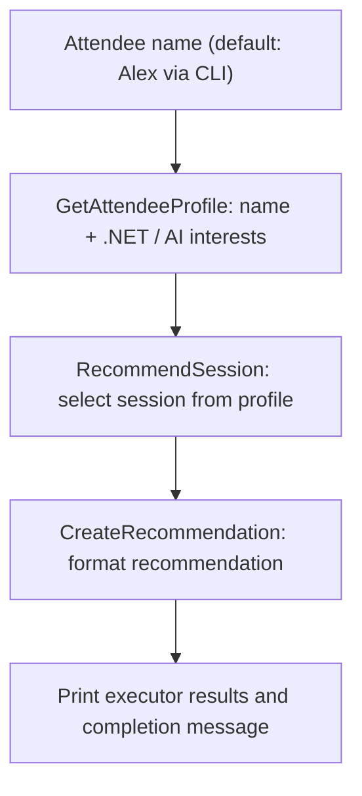
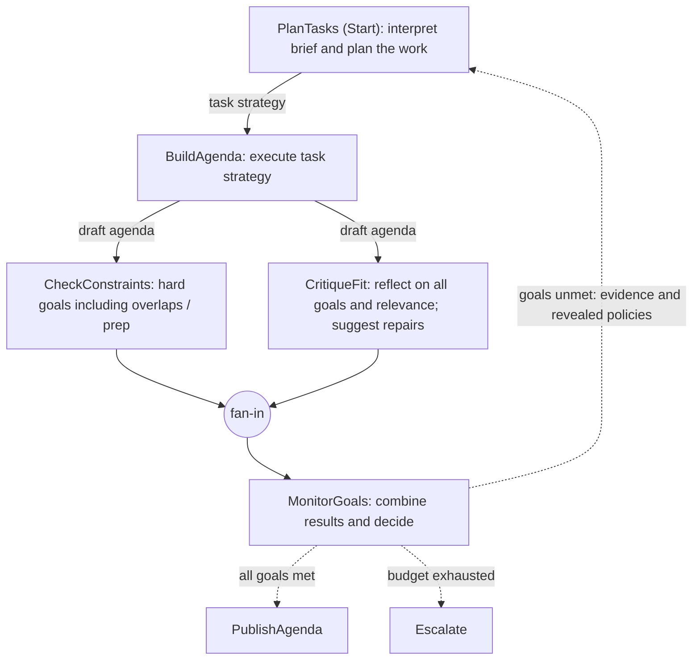
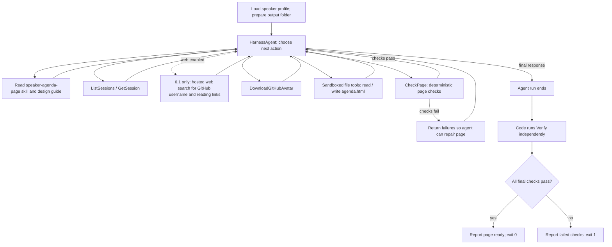

# Update Conference demo flows

Use the matching numbered profile in
[launchSettings.json](ConferenceDemos/Properties/launchSettings.json).
Run the commands below from `update-conference-26`.
See the [demo guide](README.md#demos-in-presentation-order) for configuration.

| Demo | Launch profile | Command | Flow |
|---|---|---|---|
| 2 | `2. Simple MAF workflow` | `dotnet run --project ConferenceDemos -- workflow Alex` | [Simple MAF workflow](#demo-2-simple-maf-workflow) |
| 4 | `4. Planning and goal monitoring` | `dotnet run --project ConferenceDemos -- plan` | [Planning and goal monitoring](#demo-4-planning-and-goal-monitoring) |
| 6 | `6. Harness` | `dotnet run --project ConferenceDemos -- speaker-page --open` | [Harness agent](#demos-6-and-61-harness-agent) |
| 6.1 | `6.1 Harness + web search` | `dotnet run --project ConferenceDemos -- speaker-page --web --open` | [Harness agent with optional web search](#demos-6-and-61-harness-agent) |

## Demo 2: Simple MAF workflow

[WelcomeWorkflowDemo.cs](ConferenceDemos/Demos/02-SimpleMafWorkflow/WelcomeWorkflowDemo.cs) uses three
delegate executors. This is a deterministic workflow, not an LLM agent:
the attendee profile is constructed in code and the recommendation is selected
by an `AI` substring check.

## Demo 4: Planning and goal monitoring

[AgendaPlanningDemo.cs](ConferenceDemos/Demos/04-PlanningAndGoalMonitoring/AgendaPlanningDemo.cs) owns the workflow
edges below. Planning includes interpreting the current brief; there is no separate
`ReadGoals` executor. The task strategy is consumed by a separate agenda builder.
The initial brief omits overlap avoidance and the 12:30 preparation policy, which
both reviewers know from the start. The monitor reveals failed goals and forwards
the critic's repair advice to planning. These policies stay
in subsequent planning inputs. First-round success remains possible.

The one-round launch profile uses this same graph with a smaller budget; it
escalates only if the goals are still unmet. An editable presentation companion
is available in [draw.io format](planning-and-goal-monitoring.drawio).

## Demos 6 and 6.1: Harness agent

[SpeakerPageDemo.cs](ConferenceDemos/Demos/06-Harness/SpeakerPageDemo.cs) configures one
`HarnessAgent`, not a fixed `WorkflowBuilder` graph. This diagram shows its
tool-selection loop and the code-owned final verification. The model chooses
tool order and may repeat calls; the skill guides it to check and repair the page.

Demo **6** supplies the GitHub username and disables web search. Demo **6.1**
omits the username from the prompt and enables hosted web search to find it
and further-reading links. Both variants download the photo over HTTP.

With `--open`, the CLI opens an existing page after reporting the checks, even
when checks fail. Exceptions or cancellation follow the CLI's error path
rather than reporting success.
